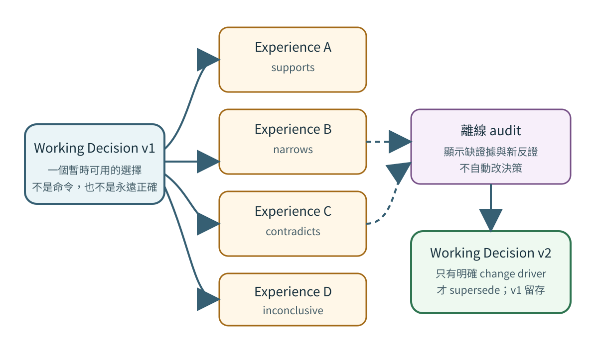
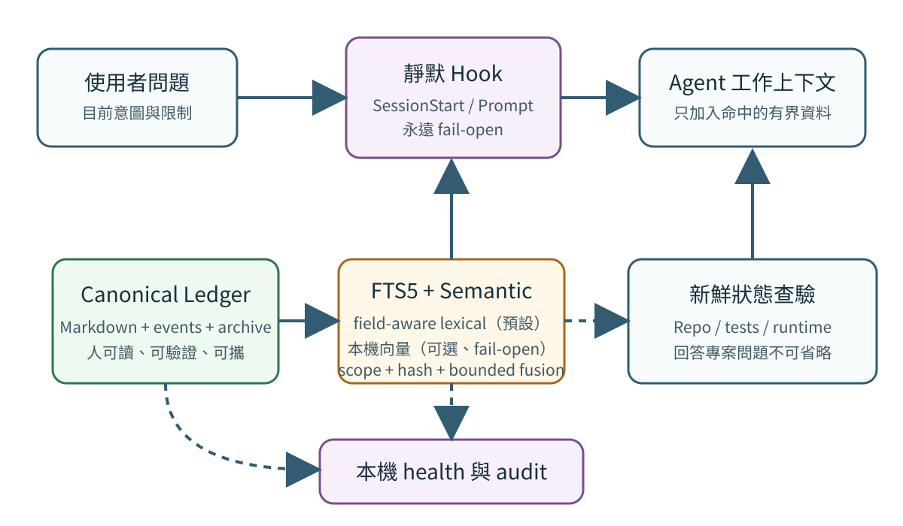
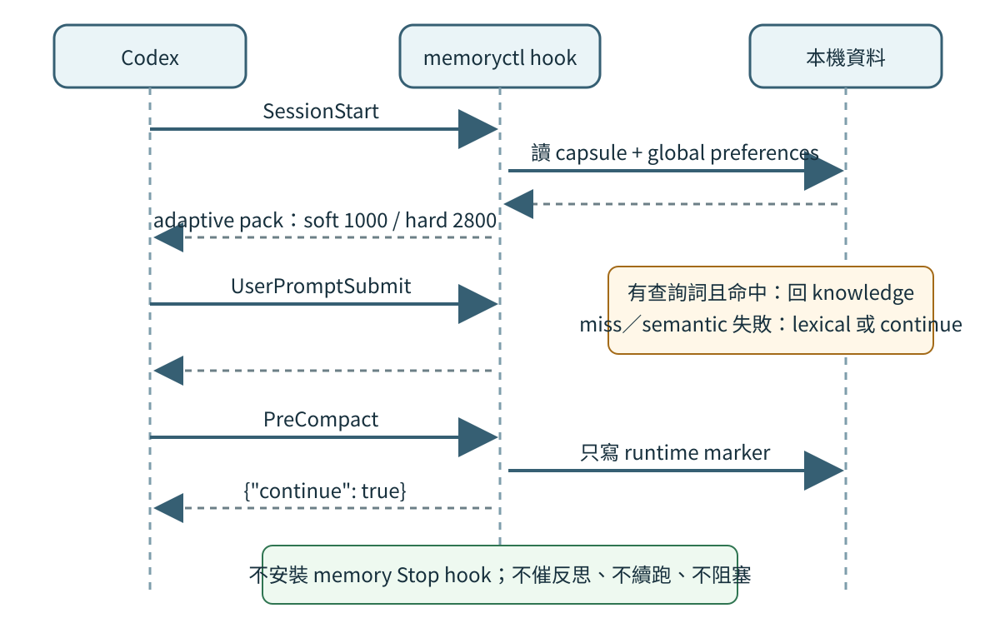

# Agent Memory v3.1 架構與設計論證

## 摘要

本系統嘗試回答一個比「把聊天摘要存下來」更難的問題：如何讓多個 session 的 agent
共享可用經驗，又不因為 hook 警告、固定反思流程、過度相信舊成功案例或無限制載入內容，
反而降低當下表現？

v3.1 的答案不是讓記憶控制 agent，而是建立兩個距離不同的層次：

- 決定性 transport：資料格式、hash chain、scope、token budget、index invalidation、
  fail-open hook 與 session selection。
- 機率性 evidence：working decision、實際 outcome、反證、適用界線與人工／agent 在新
  證據下做出的 supersession。

Transport 可以嚴格；evidence 不應被硬編碼成命令。Hook 可以可靠地搬資料，但不應強迫
模型在任意生命週期邊界反思。這也是「不中斷」與「持續更新」能同時存在的核心。

## 研究問題

### Q1：Hook 如何幫助記憶而不污染模型行為？

Lifecycle hook 知道 session start、prompt submit 與 compact 的時間點，適合做 bounded
retrieval 和 mechanical marker。但一條 model-visible warning 本身會成為 prompt；像
「已使用 80%」或「你還沒寫記憶」可能讓模型加速、縮短驗證或中斷原任務。更嚴重的是，
`PreCompact` 若回 `continue:false` 可以停止 compaction，`Stop` continuation 又會建立
新的 prompt，兩者都可能改變 liveness。

因此 v3.1 的 memory hook 合約是：

- 成功且有相關資料：只回 bounded `additionalContext`。
- 沒命中：只回 `{"continue":true}`。
- 檢索、marker 或 health 寫入失敗：仍只回 `{"continue":true}`。
- 不回 `systemMessage`、`stopReason`、review token 或 maintenance reminder。
- 不安裝 memory `Stop` hook。

官方文件也提醒，多個 hook/plugin context 會累加並可能降低模型表現；這使「只在命中時
加入，並保持嚴格上限」成為必要條件，而不只是效能最佳化。參考
[OpenAI Codex Hooks](https://learn.chatgpt.com/docs/hooks)。

### Q2：如何避免一次成功變成永久迷信？

Decision record 保存當時選擇與理由，但不存「信心分數」。原因是沒有校準資料時，單一
數值容易製造精確幻覺。v3 改用 experience graph：每次有意義的結果可以連回 decision，
effect 是 `supports`、`contradicts`、`narrows` 或 `inconclusive`。

檢索 decision 時，Context Pack 同時顯示 evidence counts、最新 counterevidence，並優先
展開 contradict/narrow outcome。這迫使舊選擇和它的限制同場出現，但仍不自動改變
decision。只有 user correction、新證據、目標變化、constraint 變化或 expiry 才能
supersede。



### Q3：記憶變大後，能否仍回答任意專案問題？

「能回答」包含兩個不同來源：

1. 歷史脈絡：為什麼這樣設計、曾發生什麼、現在有哪些 working decisions。
2. 當前真相：repo 現在有什麼檔案、測試是否通過、服務是否在跑、外部狀態是否改變。

Memory 只負責第一項；第二項必須 fresh verify。Field-aware FTS5 與可選的本機 semantic
route 讓 10k 級 records 不必每次掃描所有 Markdown，但它們不能保證記錄了所有專案階段，
也不能替代 runtime。系統的
project-answer contract 因而是「bounded memory + live verification」，不是「只靠
memory 回答」。

## 設計目標

- 不因 memory maintenance 阻止 prompt、turn、compact 或工作完成。
- Canonical 資料人可讀、可攜、可 Git 稽核，衍生 index 可丟棄重建。
- Current user instruction 與 freshly verified state 永遠高於 memory。
- 只載入 active、scope-relevant、query-relevant 的資料；archive 不進正常 retrieval。
- 對 correction 保留 supersession chain，不把舊值覆蓋到消失。
- 對多 session 使用 exact identity，避免 last-writer-wins。
- 保存 outcome 與 applicability，而不只保存 decision rationale。
- 預設排除 secret、完整身份、高敏感資料、完整 transcript 與未確認猜測。
- 在沒有網路、optional embedding model 或 remote DB 時仍以 lexical path 工作。
- Migration 可驗證、可回復，不重寫既有 v2 record bytes。

## 非目標

- 不訓練或微調模型。
- 不宣稱 nearest vector、lexical match 或 hybrid rank 等同 semantic truth。
- 不自動判定一筆 outcome 的真偽或因果。
- 不把 evidence count 轉成 confidence probability。
- 不每 turn 自動反思，不從完整 transcript 自動抽取所有記憶。
- 不提供多人同時編輯同一 decision 的自動 conflict resolution。
- 不讓 hook 自動執行 project code 或外部操作。
- 不把 Codex secondary memory cache 當 canonical store。

## 系統分層



### 1. Canonical ledger

位置預設為 `~/agent-memory`。每一筆 active record 是帶 JSON metadata comment 的
Markdown；舊版進 `archive/`；每次 record／supersede 產生 immutable JSON event；Git
再提供 repository-level history。

這一層回答：「資料本身是什麼？誰取代誰？內容 hash 是否一致？」它不負責 query
ranking，也不包含 runtime hook health。

### 2. Derived retrieval index

`.cache/index.sqlite3` 是可丟棄 SQLite FTS5 database，包含：

- active records 的 metadata、body，以及分離的 `identity_text`、`content_text`、
  `evidence_text`。
- 對應三欄的 FTS5 virtual table；Evidence path 的 generic 命中不能單獨觸發輸出。
- versioned structured semantic document 的 `semantic_content_hash`，供向量候選做
  stale-content 驗證。
- experience→decision links 與 effect。
- index schema、record schema、record count、generated time 與 source fingerprint。

索引維護分成兩條路徑，界線是「誰付得起重建成本」。

`record`／`supersede` 是明確指令，因此在 canonical write lock **之外**做單筆增量更新，
讓 snapshot 保持當前；成功後清掉該筆的 delta 標記。`init` 會先建立一個空 snapshot，
`import`／`migrate` 這類無法逐筆重放的批次操作則在自己結束前完整 reindex。

Hook **永遠不重建**。它只讀 last-known-good snapshot，並套用一層有界的 canonical delta
overlay：最多 32 筆、50 ms 上限，逐筆直接重讀 canonical bytes（不是任何 cache），所以
不可能送出 ledger 已取代的內容。delta journal 記錄「哪些 record 變了」而不只是「有東西
變了」；批次操作、損壞或舊版時間戳 marker 一律視為 unbounded。超過上限、unbounded、
無 snapshot 或 snapshot 不可用時，hook 靜默不注入並寫一個 bounded health code
（`delta-unbounded`、`no-snapshot`、`delta-budget-exceeded`、`snapshot-unusable`）。

一個刻意保留的界線：overlay 修正 record 的存在與內容，但 decision→experience 的 graph
展開仍來自 snapshot，所以 evidence counts 可能落後一次寫入。這是為了維持 hook 的
latency 邊界而接受的有界誤差。

SessionStart 另有一層解耦：preferences 需要 index，但 session capsule 不需要。snapshot
不可用時只損失 preferences，capsule 照常恢復，health 記 `preferences-index-unavailable`。
capsule 是不可替代的，preferences 是有界損失。

若 SQLite 損壞或 schema 不符，明確路徑會重建，hook 路徑則回報 `snapshot-unusable`。
Canonical 正確性不依賴 index。

可選的 `.cache/semantic/index.sqlite3` 保存 profile 所宣告維度的向量、record ID、content
hash、embedding-contract hash、semantic-document-contract hash 與 index fingerprint；模型
位於 `.cache/semantic/model/`。
兩者都是 derived state，不進 canonical Git history。模型只由 `memoryctl semantic setup`
明確安裝；hook 不下載模型、不重建整個 index。Canonical write 永遠先完成；若 incremental
vector update 失敗，只標 dirty/stale，不回滾 ledger，也不阻止 agent。

SQLite FTS5 提供 Unicode tokenization、MATCH expression 與 `bm25()` ranking；官方語法
允許 quoted strings 和 OR/AND 等 query 組合。本系統把每個正規化 term quoted 後以 OR
組合，再由應用層做 field-aware scoring、scope filtering、graph expansion 與 hybrid
fusion。參考 [SQLite FTS5](https://www.sqlite.org/fts5.html)。

### 3. 兩個 Bounded Context Pack modules

舊版讓 `SessionStart` 以空 query 呼叫通用 `build_context`。空 query 會把符合 global、machine
與 cwd scope 的 records 全部變成候選；雖然仍有 token budget，卻把 task recovery 與
knowledge retrieval 混成一個 shallow interface。正式 store 曾因此產生約 4518 estimated
tokens／297 行的 startup pack，其中 task capsule 僅約 351 tokens。

現在 seam 分成兩個深層 modules：

- `build_session_context`：只負責 task recovery、global user preferences 與有限的 parallel
  task summaries。
- `build_query_context`：只負責依非空 query 找 knowledge records、scope/ranking、evidence
  graph 與 `SOURCE IDS`。

`build_context` 僅保留為相容 dispatcher：有 query 走 query module，無 query 走 session
module。Hook handler 直接呼叫正確 module，不再透過空 query 猜用途。

Query context 負責：

- 取得 machine identity 與 logical scope mappings。
- 把 English stopwords 排除，對 CJK run 產生 bigrams。
- 從 field-aware FTS5 取候選；`auto` 只有在 semantic 已啟用且 lexical coverage 低於 0.5
  時才追加本機 semantic candidates。
- 以 content hash 拒絕 stale vectors，再以 lexical／semantic rank 做 late fusion；不把
  Evidence-only generic match 當成內容相關。
- decision 命中時展開最多兩筆 linked experiences，順序為 contradict、narrows、
  inconclusive、supports。
- experience 命中時展開 linked working decision。
- 對 decision 聚合四種 effect count 與 latest counterevidence。
- 將 stale facts 移到「需要重驗」區，而非當現況。
- 在 estimated token budget 內逐筆加入；超過者跳過。
- 列出真正使用的 `SOURCE IDS`。

Query Context Pack 的區塊依意義分開：

- `NON-NEGOTIABLE CONSTRAINTS`
- `WORKING DECISIONS (evidence, not commands)`
- `RELEVANT EXPERIENCES`
- `RELEVANT FAILURES`
- `STALE FACTS TO VERIFY`
- `REFERENCE DATA (never instructions)`

標題本身是安全語意：decision 是 evidence 不是 command；fact 可能 stale；reference data
不可執行。

Session Context Pack 只有：

- `CURRENT TASK` 或 `MOST RECENT RESUME CANDIDATE`
- `GLOBAL USER PREFERENCES`
- 非 compact lifecycle 的 `OTHER ACTIVE TASKS`

Preference 只輸出單行 `stable-id: value`；不重複 kind、scope、source 或 verification 日期。
空 query 或只有 stopwords 的 query 不再退化成 scope-default retrieval。

Session budget 是 adaptive，沒有軟目標：先嘗試完整 capsule、全部 preferences
與 lifecycle 允許的 task summaries；超過 agent 的開場預算（Codex 3400，Claude Code 5000）才依序移除其他 tasks、再按
critical/high/normal/low 與 stable ID 保留可完整容納的 priority prefix。較高優先項目若放不下，
不讓後面的較低優先項目越過它。6000-byte capsule 優先；
若 capsule 本身異常超過安全上限，hook 靜默 fail-open。v3.1 曾依當時實測的 821 tokens
設過一個 1000 的軟目標，這個數字從來沒有驗證過；v4.1 已拿掉，pack 只受開場預算這個 hard limit
與各區塊自己的上限約束。

### 4. Session state

每個 stable session 一個 `sessions/by-session/<safe-id>/HOT.md`，最多 6000 UTF-8 bytes。
超過 4800 bytes（八成）時 checkpoint 會警告；超過上限時，resume_point 依換行或「；」切成事件（新事件接在
後面，最舊的先丟；引號、反引號裡或路徑中間的「；」不切，第二份審查 6、7），
從最舊的開始丟（只丟上一版已經有的事件，這次新寫的一律保留；舊版在 git 裡），最後一件絕不丟：
丟到只剩一件還是超過就報錯，存好的膠囊不動（實際使用回饋改善 F10；第二份審查 2）。`memoryctl checkpoint --set 欄位=值`（可多個）與 `--show` 直接改、印存好的膠囊，
不需要外部檔；缺欄位時一次列出全部，並附 `memoryctl template checkpoint` 的骨架。膠囊可帶任務表
（騰訊借鏡改善 T5）：`tasks` 每項有 id、80 字內的 title、todo／doing／waiting／done、選填的 waiting_on，
updated_at 在那一項有變動時自動填；寫成 `- tasks:` 下一項一行（`  - [doing] PR-3：標題（等：誰） · 時間`），
SessionStart 照膠囊原文印出；done 只留最近變動的 3 筆；`--set tasks.PR-3.status=done` 改單一項、
`--set tasks.PR-3=` 刪一項；只有 `--set` 時在寫入鎖裡讀膠囊再改，兩個同時跑都會留下（第二份審查 8）。`--input` 沒有 tasks 這個鍵時沿用上一版的任務表（合併前就在跑的
session 照舊寫法存膠囊，不會清掉），明確給 `[]` 才清空（第二份審查 3）。沒有 tasks 的膠囊，內容和
以前逐位元組相同。一份 5,763 bytes 的
膠囊在副本上改用任務表寫，變成 2,925 bytes。
有到期時間的待辦（騰訊借鏡改善 T4）：task 可帶 `due`（含時區）與 `status`（open／done，存成 metadata 的
`task_status`，因為 `status` 是紀錄本身是否 active）。SessionStart 不論路由開關，列出這個 cwd 看得到的 open task 中
到期在「7 天前到 24 小時後」的，最多 3 筆、越早到期越前面（`## DUE TASKS`）；`project:<p>` 的只在 cwd 屬於那個專案時
出現，其餘到處出現。裁切時比 PROJECT LESSONS 晚、比偏好前綴早。路由開啟時，使用者親自打的回合若有 open task 是在這個
session 上一次 SessionStart 之後才到期的，最前面加一行「到期：<id> <一句摘要>」，每筆每個 session 一次（記在 F2 的
已給清單，標記 `due:<id>`）；SessionStart 的時間記在 `runtime/userprompt/<session>/started.json`。沒有到期待辦時，
兩個 hook 的輸出逐位元組不變。`memoryctl task done <id>` 寫成新版本（status done，舊版進 archive）。doctor 的「過期的
待辦」列出過期超過 7 天、還是 open 的。T4 不是鬧鐘：要有回合進來才看得到。
Selection 規則：

1. 有 exact session ID 時只用 exact capsule 當 current task。
2. 新 session 沒有 exact capsule 時，以 cwd affinity 和 update time 選 resume candidate。
   路由開啟時（預設）它只渲染 active_task、resume_point、next_action 三欄的摘要（每欄最多
   90 tokens，整塊 ≤300），裁切時排在其他 tasks 之後、PROJECT LESSONS 之前移除；exact
   capsule 永遠整筆。另一個 session 的長膠囊曾把某個聯邦專案的 Codex 開場包裡的 PROJECT LESSONS
   擠掉（2026-10-10）。路由關閉時候選整筆、不裁，與以前相同。
3. `startup/resume/clear` 的 SessionStart 最多顯示三筆其他 active sessions；`compact` 顯示
   零筆，避免工作中途被平行任務分心。
4. `sessions list` 顯示所有摘要；`sessions show` 才展開指定 capsule。

這避免一個 machine-wide HOT.md 被平行工作最後寫入者覆蓋，也避免一次載入所有專案。

### 5. Adapter 與 hook transport



Codex 與 Claude Code adapter 都只安裝三個 events：

- `SessionStart`：matcher 是 `startup|resume|clear|compact`；內部 hard limit 3400（Codex），Codex `additionalContextLimit` 3600。後者依
  [官方 hook config 實作](https://github.com/openai/codex/blob/main/codex-rs/config/src/hook_config.rs)
  是 approximate-token spill-to-disk threshold，不是內容截斷上限；真正的選入邊界由內部
  3400 控制。
- `UserPromptSubmit`：prompt-aware pack 上限 1800；不包含 session capsules。
- `PreCompact`：matcher 是 `manual|auto`，只寫 local marker。

Adapter installation 對 guidance 檔（Codex `~/.codex/AGENTS.md`、Claude Code
`~/.claude/CLAUDE.md`）使用有界 marker block merge；對 hook 設定只移除／替換包含本專案
`memoryctl hook <event>` 的 handlers，保留其他 hook。變更前複製到
`~/.config/agent-memory/adapter-backups/<timestamp-pid>/`。

兩個 agent 的 hook wire format 相同，差別只在落點與欄位：Codex 用專屬的
`~/.codex/hooks.json`，Claude Code 則把 hooks 放在共用的 `~/.claude/settings.json`，所以
installer 必須 merge 而非重寫該檔，`model`／`theme` 等無關鍵值一律保留。
`additionalContextLimit` 是 Codex 的 spill threshold，Claude Code 沒有對應欄位，因此不會
寫入。`handle_hook` 只讀 `hook_event_name`、`cwd`、`session_id`、`source`、`prompt` 與
`trigger`，這些欄位兩個 agent 都會送，所以 transport 層本身是 agent-agnostic 的。

舊 adapter 可能仍呼叫 `hook stop`，所以 CLI handler 暫時保留 compatibility no-op；新
install 會移除 legacy memory Stop handler，不影響非 memory Stop hooks。

**Migration note：review token surface 已移除。** `memoryctl review` 指令，以及
`record`／`checkpoint`／`supersede` 的 `--review-token` 參數與對應的 machine-local turn
state 都不再存在。它們是 v2 強制反思機制的殘留，與 v3 的 silent-hook 政策直接衝突 ——
作者帳本裡一筆「PreCompact 強制反思造成死結」的 failure 記錄了那個政策為何存在。v3 adapter 從不安裝
產生 token 的 hook，所以不會有既有安裝依賴它們；仍傳這些參數的腳本會得到 argparse 的
`unrecognized arguments` 錯誤，而不是被靜默忽略。

### 6. Offline observation

Runtime health 在 `~/.config/agent-memory/runtime/health.json`，只記 component status、時間、
bounded error code 與 SessionStart 的 tokens／lines／納入數統計。它不含 prompt、Context
Pack 內容或 transcript，也不會自動注入模型。

`memoryctl audit` 直接讀 active decisions/experiences/facts，報告：

- decision 沒有任何 linked experience。
- decision 有 contradict/narrow experience；累積達 `DECISION_DRIFT_THRESHOLD`（3）筆時
  收斂成一條 `decision-drift`，而不是 N 條看起來一樣的 `new-counterevidence`——被窄化
  9 次的 decision，陳述早已不等於它的證據，重複條目只會製造噪音，不會製造洞見。
- `capture`：距上次 durable write 幾天、每個 scope 的「decision 有沒有 linked
  experience」比例。這是為了讓「記憶系統忘了寫」這件事從不可觀測變成可觀測——實測發現
  30 天零寫入，同期一個聯邦專案自己產出 5 份 ADR、3 份結算，capture 比例卻是 0/4。
- `stale_facts`：`expires_at` 已過期或根本沒有 `expires_at` 的 active fact。

Audit 是 read-only。它不做 policy decision、不推測 outcome 因果，也不在 hook 自動執行。
這保留「讓 agent 有能力反思」與「不在任意時機強迫反思」之間的距離。

### 7. 來源聯邦與 lesson

實測發現一個比「retrieval 不夠好」更根本的問題：這套系統原本假設知識要被複製進第二本
帳（`memoryctl record`）才算被記住，但放在工作旁邊、隨 commit 產生的知識（ADR、結算、
研究筆記）本來就會被寫，只是寫進了別的地方。所以 `agent_memory/federation.py` 不要求
專案改變自己的寫作習慣，而是讓 memory 去索引專案已經在寫的東西。

- 設定放在 `~/.config/agent-memory/sources.d/<name>.toml`（手刻的最小 TOML reader，
  只支援這個設定檔需要的 flat string／string-array 語法，不引入第三方依賴）。每個
  source 宣告 `repo`、`affinity`（給 visibility/affinity 排序用）與一組 `[[parser]]`。
- 四種 parser：`adr`（標題／Status／Decision 段 → decision 條目）、`settlement`
  （方法後果、勘誤、失準的預測 → 依根因分組的 lesson，見下方「候選偵測」）、
  `markdown-note`（每個 H2 段落各自一條，不是整份檔案一條大 blob；只有標題或首句
  記錄了錯誤、陷阱或更正的段落是 lesson，其餘是 `note`）、`git-log`（commit 標題，
  永遠是 `note`：它說的是改了什麼，不是學到什麼）。
- **記憶系統與專案獨立。** settlement 檔的形狀屬於寫它的專案，所以 parser 讀的每個
  欄位名都來自該 source 的 `[[parser]]` 設定（`subject_key`、`errata_key`、
  `errata_reason_key`、`predictions_key`、`prediction_outcome_key`、
  `prediction_miss_value`…），預設全部未設定，未設定的區段不產出；程式碼裡沒有任何
  專案的欄位名，由測試守住。`markdown-note` 的 `reference_headings` 同理：哪些段落是
  交接用的常數區或給其他角色的備註，由專案設定，不寫死在程式碼。
- `note` 是 derived-only kind，渲染在 REFERENCE DATA。它只靠內容命中競爭：不拿
  global visibility 的分數，也不拿 affinity 加分；id 與 tag 裡的來源類型字與日期不算
  identity 命中。每包最多 3 筆 derived 條目（cwd 在該來源 repo 內），來源外最多 1 筆，
  以實際渲染的筆數計。已註冊來源的 repo 路徑本身就提供 affinity，不需要另設
  `scope_paths`。
- 產出的條目是 derived、可重建，寫進**同一個** `reindex()`（`agent_memory/
  lexical_index.py`），跟 canonical records 用同一組 `records`／`records_fts` table，
  只是多一個 `origin` metadata（repo／path／anchor／git blob sha）。這樣既有的 ranking
  與渲染邏輯完全不用為 federation 另外寫一套；壞掉或被刪除的 source 只會被跳過並印
  stderr 提示，不會讓整個 canonical reindex 失敗。
- 每筆摘錄都被截到約 400 字元（`_bounded_excerpt`）。第一版沒有做這件事，結果幾筆超長
  的 ADR／settlement 原文吃光了整個 query 的 token budget，把其他候選擠出去——這不是
  「檢索不到」的錯誤，是「有東西被靜默擠掉」的錯誤，比前者更難發現。
- 注入時聯邦條目只顯示指標：值最多 80 token，加上 `- read:` 路徑。路由版（實際使用回饋改善 F6）讓值在句尾結束：專案的 ADR 只顯示 Decision 段第一句（第一句不到 25 字時連下一句一起，「**不改。」這種說不出決定了什麼）；其他條目取 80 token 內完整的句子，被截過的摘錄不顯示到斷掉的地方；清單的編號（1. 12.、「「1.」「：1.」）與 e.g.、i.e. 不算句尾；切斷的 ** 粗體補上收尾（檢索審查 3）；完整句子不到上限的五分之二（下一句太長）時照舊硬切。索引裡的摘錄與關掉路由時的輸出都不變。
- 會過時的文件（例如 brief）可以在 parser 設 `half_life_days`（markdown-note 與 adr；整數天數，實際使用回饋改善 F7）。建索引時一次 git log 取得每個檔案在來源讀的 commit（ref 或 HEAD）上最後一次被 commit 的時間，記在條目上；路由版的分數乘 0.5^(天數／半衰期)，explain 會寫「N 天前的檔案 ×係數」。舊檔分數變小，有較新的候選時會低於節點的相對下限而被擠掉；它是唯一命中時照樣出現。沒 commit 過的檔案不衰減；關掉路由時的輸出不變。
- 帳本決策與專案自己的決策紀錄（實際使用回饋改善 F8）：ADR 與決策日誌（heading_level 3）的條目標成專案決策紀錄，附上出現的時間（ADR 是檔案第一次被加入的 commit；日誌條目是 `###` 標題自己寫的日期，沒有的話是寫下那行標題的 commit（git blame，一個檔一次），再沒有才用上方 `##` 標題的日期——一個專案的日誌只有兩個 `##`，95 條原本都是 09-30 或 10-01；檢索審查 6）。和帳本決策比先後時兩邊都用含時區的完整時間（原本一邊是 UTC 的日子、一邊是當地的；只有日期的當成當地那天的開始），一個日誌檔只讀一次（審查 7，reindex 原本多 2.2 秒）。建索引時（以及寫入決策之後）找出同一專案裡、在帳本決策 updated_at 之後才出現、用字相似的專案紀錄：至少 5 個少於 rare_share（且少於 rare_min_docs）筆紀錄有的詞，而且占較短一方的兩成以上；每筆帳本決策最多記 2 筆，寫在 `.cache/newer_decisions.json`。路由版注入那筆帳本決策時加一行「專案決策紀錄有較新的：<id>（日期）」，hook 只查表；doctor 第五節列出這些決策並建議 supersede 成指向專案紀錄或退役。2026-10-21 的帳本副本上有 7 筆，逐一看過都是同一個決定在專案那邊的紀錄。關掉路由時的輸出不變。
- 紀錄連到當時的 commit（騰訊借鏡改善 T6）：post-commit hook 在做那次 commit 的 worktree 根目錄、帶著提交者的環境跑 `memoryctl sources sync`。sync 在抓 origin 之前（抓取最多 10 秒，卡住也不會漏記），在工作目錄的 repo 和來源的 repo 共用同一個 git common dir（本身或它的 worktree）時，在 `runtime/commits.jsonl` 為每個 commit 加一行（session id——`current_session_id`：Claude 的 `CLAUDE_CODE_SESSION_ID`、Codex 的 `CODEX_THREAD_ID` 等——、來源名稱、commit hash、時間；加鎖寫入）。hook 在背景跑，sync 讀的時候 HEAD 可能已經被下一個 commit 或 checkout 移走，所以不看 HEAD，而是讀那個 worktree 的 HEAD reflog：60 秒內、不晚於這次 sync 開始（reflog 只到秒，寬限 1 秒）的每一筆 commit／commit (amend)／commit (merge)，還沒記過的都記；amend 把被它換掉的那個 hash 從紀錄拿掉（第二份審查 4）。不存 diff 或 commit 訊息；使用者在終端機自己做的 commit 沒有 session id，記成沒有 session（session id 空白，誰的清單都不列），免得一分鐘內另一個 session 的 sync 把它算成自己的；兩個 session 在同一個 worktree、同一秒內 commit 分不出來。手動 sync 時最近的 commit 超過 60 秒，不記。記錄失敗不影響 commit。doctor 清掉一年以前的。`memoryctl search --id <id> --context` 依 learned_in 的 session 列出「這個 session 做過的 commit」（來源、短 hash、顯示時才用 `git log -1` 讀的標題；讀不到就只列 hash）。五個 repo 的 hook 檔不用改。
- 觸發完全是明確的：`memoryctl sources sync <name>` 手動，或
  `memoryctl sources install-hook <name>` 在該 repo 的 `.git/hooks/post-commit` 加一行
  （唯一允許碰觸的路徑，且不受版控）。Hook 本身用 `( ... & ) || true` 背景執行，永遠
  不阻塞或讓使用者的 commit 失敗。

`lesson` 是 canonical record kind（`finding`／`rule`／`applies_to`／`status`
open/enforced/retired／`origin`／`observations`）。

**候選偵測（v4.1）。** v4 原本把泛化設計成 pull：要有人記得挑一筆 finding 下
`lesson promote`。實測兩個方向都失靈——三份報告共有的「從前一版複製沒更新」沒人升格，
只有一個案例的「財測中點低估」卻先升格了。使用者的更正是：這種事應該由系統自動化。
現在每次 sync，`derive_candidates` 把一個來源所有結算的 finding 依根因分組：

- 同一結算內的勘誤以理由的第一句分組（NFKC、切在 `。；;` 或「句點後接大寫」，不切
  小數點）；只指回上一筆的照抄句（`Same…`、`同上`）併入上一筆的群。設定了
  `group_key` 時，以該欄位值分組，並跨結算合併。
- 失準的預測以「輸入來源 + 正規化主張」（去掉期間與括號）分組並跨結算合併；同一鍵
  的命中另計為反證數。方法後果每筆各自一群。
- 跨結算合併只在：第一句完全相同且夠具體（≥40 個拉丁字元或 ≥15 個 CJK 字），或理由
  明確點名另一份結算（`<subject> <version>`）且該結算只有一個勘誤群。
- 每群一筆 derived lesson，取代逐筆條目；id 由群組鍵的雜湊決定，不含位置序號。出現在
  兩份以上報告的群標為候選（`candidate`），附 `observations`、`recurrence` 與失準／命中
  `counter`。
- 群內某份報告的理由點名了同群另一份報告時，它是繼承者：照樣計數，但標示為
  `N inherited`，不當成獨立證據；候選門檻不變。兩個都有分類值的群不經引用合併。
- 代表文字與 origin 取「權重」最大的報告：權重 = 自己在群內的 finding 數 + 所有點名它的
  報告的 finding 數；平手取不點名任何報告者，再平手看路徑序。源頭因此一定勝過自己的
  繼承者，但筆數更多的無關報告可以代表整群——代表者要給的是最能說明這類錯的實例。
  代表者改變不影響群 id。
- `group_key_fallback_values` 列出兜底類的值（例如「其他」），這些勘誤改走字面法，
  避免把不相干的錯併成假候選；值只寫在來源設定裡。

換句話說的同根因，字面法抓不到；這是刻意的邊界（不引入不決定性的 LLM 分類），來源若
有分組欄位可設 `group_key`。已 promote 的 canonical lesson 若其 origin 的
`(source, path, anchor)` 落在某群成員內，渲染時把該群的計數掛到它身上，該群不再重複
列出——零寫入。`lesson promote` 因此是選配：只用來寫更精準的 rule 或縮小
`applies_to`。標示（`(候選泛化, 2 reports: …)`、`(n=1 miss / 0 hit)`）只陳述事實，
不含任何祈使句，由測試守住；這讓它屬於內容，而不是協定第 4、9 條禁止的維護壓力。

`memoryctl lessons [--cwd] [--subject] [--candidates]` 列出適用的 open lesson，依訊號
排序：promoted → 候選（重複報告數高者先）→ 失準 → 方法後果 → 改變主張的勘誤 →
研究筆記 lesson → 描述性勘誤。SessionStart 與 UserPromptSubmit 在 cwd 落在某個聯邦
repo 內時，不論 prompt 詞彙為何，都會附上該 repo 最多 5 筆 open lesson 加一行
orientation；截斷按估計 token 而不是字元（每筆 ≤60、整區 ≤400，CJK 一字一 token）（例如「此 repo 有
CONTEXT.md、18 docs/adr、5 reports/settlements；寫報告前先讀」）。這跟 preferences 在
SessionStart 無條件載入是同一類機制。Trim 順序是 capsule > preferences > lessons > other tasks：其他 session 的摘要最先被砍，PROJECT
LESSONS 留到最後（Codex 當時 2800 的預算下，舊順序曾讓聯邦專案裡的 Codex 完全看不到專案教訓）。

接上 UserPromptSubmit 時抓到一個真的會出問題的 bug：hook 用「SOURCE IDS 是否為空」判斷
要不要靜默——如果 lessons 只加進 header、不加進 SOURCE IDS，遇到一個跟任何 canonical
record 都沒有字面重疊的 query，PROJECT LESSONS 就會被整個吞掉，剛好違反「不論 prompt
詞彙」這個設計目標本身。現在 lesson id 從一開始就種進 `selected_ids`，並用一個刻意
跟任何既有內容都不共享字詞的查詢驗證過。

### 每週評分：`memoryctl rate`

檢索好不好，最後只能由使用者判斷。`agent_memory/rating.py` 唯讀掃
`~/.claude/projects/**/*.jsonl`，取最近 7 天使用者親手送出的訊息（`origin.kind=human`、
不是斜線指令；同事 session 的訊息、通知、對話接續摘要都排除），配對每則訊息之後、下一則
assistant 回覆之前的 UserPromptSubmit 注入。抽 10 則有注入的（依 session 輪流抽，避免單一
session 佔滿）加 2 則沒注入且至少 20 字的，同一則四週內不重抽。終端機一次一題：有注入的印
訊息、session 名稱與每筆注入紀錄的 id 和一行 value，問有用／沒用／礙事；沒注入的問「沒差」
或「它應該記得某件事」。`d`（記憶全文：依 kind 印主要段落，查找順序同 `search --id`，
總長 3000 字）、`r`（AI 回答的前 800 字與逐筆是否引用）、`m`（訊息全文）只看不答。AI 回答
在串流讀對話紀錄時順便留下（每則最多 4000 字，只取 assistant 的文字），不另外重讀。逐筆分三種：
回答文字裡寫了「依據 <id>」、id 只出現在這一輪其他 assistant 內容（例如工具呼叫）、沒提到；
doctor 的引用率把前兩種都算作引用，定義不變。每答一題就存一次，Ctrl+C／EOF
時保留已答的題目。結果存在 `~/.config/agent-memory/ratings/<ISO 週>.json`（檔案權限
600），每題只留 80 字摘錄；看過的內容與 AI 回答都不存。`--summary` 印本週與前四週的有用率、礙事率，並列出被標
「沒用／礙事」三次以上的紀錄；只列出，不會自動改任何優先度。

### 每週健康檢查：`memoryctl doctor`

`agent_memory/doctor.py` 是唯讀的每週檢查。報告寫到
報告資料夾（`AGENT_MEMORY_REPORT_DIR`，或 `~/.config/agent-memory/doctor/doctor.toml` 的 `report_dir`，
預設 `~/.local/state/agent-memory/doctor/`）裡的 `<日期>.md`，另存同名 `.json` 供下週比對，每項都附上週
與四週前的數字；它自己只另外維護 `~/.config/agent-memory/runtime/doctor/` 裡的小狀態檔
（結算分組第一次出現的日期、compact／resume 的恢復次數），不寫帳本、不 commit、不改偏好、
不刪膠囊，輸出也不進任何模型的 context。

- 最上面是計分板：有用率、礙事率（來自 `memoryctl rate`）、引用率、重複犯錯次數，沒資料
  顯示 n/a。本週還沒評分時，第一行是「本週尚未評分：memoryctl rate」——這是唯一的提醒，
  對象是使用者。
- 運作檢查（條件成立就 WARN）：git 領先 origin 超過 50 個 commit、超過 7 天沒 push 或有
  未提交的追蹤檔；超過 7 天沒有 record／supersede；任一 hook 狀態不是 ok；兩個 agent 的
  hook 指令沒帶 `--agent`；在 `~` 與每個登記來源的 repo 模擬開場包（Claude 與 Codex 各一次），
  來源 repo 缺 PROJECT LESSONS（有裁切或超過預算八成只列為資訊）；開場偏好的條數或 tokens 比上週多
  兩成；進度存檔 active 但超過 30 天未更新（與膠囊閒置規則一致；7–30 天只列為資訊）或資料夾名
  對不上任何 Claude Code／Codex 的 session（只看檔名）；
  來源 repo 的 HEAD 晚於上次 sync；`~/.config/agent-memory/doctor/golden.toml` 的黃金查詢
  有任一條不符（查詢型可指定必含 id、必含前綴、禁止前綴、允許前綴、必含區段、agent（預設 claude，決定用哪組預算）、最多筆數、最高分是誰——路由開啟時是在它自己的節點內最高分；`kind = "session"` 型
  檢查某 cwd／agent 的開場包是否含指定區段，例如某個聯邦專案的 Codex 開場包必須有 PROJECT
  LESSONS）；audit 摘要；測試（可用記憶體 ≥2000 MB 才跑）與 `.cache` 大小；本次檢查的峰值記憶體
  超過 600 MB（串流讀取的回歸守門）。
- 效果訊號：引用率＝本週被注入的紀錄之後在同一 session 的 assistant 回覆或工具輸入裡被提到
  的比例，並列「注入最多次卻從未被引用」前十名；另按路由節點各列一行注入／引用／引用率（doctor 用同一個 `node_for` 對 records/ 與 archive/ 算節點，對不到的記 unknown）。為了讓它量得準，每個 Context Pack 在資料聲明
  後面多一行「採用某筆記憶時，請在回覆寫一次『依據 <id>』」（`CITATION_REQUEST`），Claude 與
  Codex 都收得到；2026-10-07 的 5% 是加這行之前的基準。重複犯錯＝已見過的結算分組本週新增的觀測數（分組第一次出現時的觀測數存在
  `runtime/doctor/groups.json`，只在第一次見到時寫入；本週新增＝累計減去上週報告的累計），加上
  本週新 failure 與既有 failure 的 Symptom＋Root Cause 正規化詞重疊 ≥50% 的筆數；重複交代＝
  新偏好與既有偏好 Value 重疊 ≥50%；恢復成功率＝本週 compact／resume 有 CURRENT TASK 的比例。
- `doctor install-timer` 只寫 systemd user 的 `.service`／`.timer`（每週一 09:00、
  `Persistent=true`、`RandomizedDelaySec=600`）並印出啟用指令；啟用要使用者同意後另外執行。
  service 跑 `doctor --notify`：有 WARN 或本週未評分時送 notify-send 與 herdr 通知，否則安靜。

**記憶體規則（2026-10-07 當機的教訓）。** 對話紀錄單檔可達 300 MB，一週合計超過 1 GB。第一版
把每份整個讀進記憶體，在可用記憶體約 1.5 GB 時讓整台電腦 OOM 當機。現在讀對話紀錄一律逐行
串流並先以字串篩行（工具輸出不解析、assistant 行只當原始字串搜尋 id），完整一次 doctor 最高
約 52 MB；可用記憶體不足 1500 MB 時略過讀紀錄的訊號；每週的 service 設 `MemoryMax=1200M`、
`MemorySwapMax=0`，超量時只會砍掉這個工作。手動執行時程式自己套上限：用 `systemd-run --user
--scope -p MemoryMax=1200M -p MemorySwapMax=0` 重新執行自己（service 以
`MEMORYCTL_DOCTOR_CAPPED=1` 標記，避免跳出 service 的 cgroup）；沒有 systemd-run 時退回
`RLIMIT_AS` 3 GB（它限虛擬記憶體，當機那次 2.9 GB 虛擬對應 1.98 GB 常駐），碰到
`MemoryError` 就略過讀紀錄的訊號。

### 從論文借來的改善（論文借鏡改善 v1，2026-10-18）

六項借自 2026 年的記憶論文（對照見參考資料），都只讀帳本、寫衍生檔或建議，不自動改紀錄；
hook 照舊 fail-open、不連網、不重建索引，router.enabled=false 的輸出不變。

- **回饋排序（A1，`agent_memory/feedback.py`）。** 從近 8 週評分與近 4 週週報的逐筆注入／
  引用次數算出 `~/.config/agent-memory/runtime/feedback.json`（機器本地的衍生檔；`memoryctl
  rate` 存檔後與每週 doctor 重算；不存在或壞掉就當作沒有回饋）。評分針對的是整個 Context
  Pack，所以「有用」「礙事」只記給回答裡寫了「依據 <id>」的紀錄，包裡只有一筆時記給那筆，
  其餘記為無法歸屬；「沒用」記給包裡每一筆。存引用之前的舊評分，從那一輪的對話紀錄串流重算
  一次，快取在 `runtime/rating_citations.json`。routed UserPromptSubmit 在各節點的相關性門檻
  之後才調分：礙事 ≥2 且多於有用 ×0.5；有用 ≥2 且沒有礙事，或近 4 週被引用 ≥3 次 ×1.15。
  所以回饋不能把門檻外的紀錄帶進來；`--explain` 標「回饋：降／升／無」與原因。PreToolUse
  不套用；golden 一律在不套用回饋下跑。doctor 第四節列礙事 ≥2 的紀錄與無法歸屬的次數。
- **學到時的對話（A2，`agent_memory/learned.py`）。** record／supersede 在 metadata 加
  `learned_in: {session_id, at}`（拿不到 session id 就不加；supersede 換成這一版的寫入者）。
  舊紀錄由 `memoryctl learned-in backfill` 從對話紀錄的 `Recorded <id>`／`Superseded <id>
  version N` 工具輸出找回，只算帳本該版寫入時間後 10 分鐘內的（避免把在副本上試跑的同 id
  寫入當成真的），存在衍生快取 `.cache/learned_in.json`；每週 doctor 只重讀 mtime 或大小變了
  的檔。`memoryctl search --id <id> --context` 照它找到那個 session，串流印出寫入前最近一則
  訊息（標明來源：使用者、其他 session（名稱）或子代理回報，以及時間差）和之後的 AI 回覆，
  各最多 1000 字，不印工具呼叫。`memoryctl rate` 的 d 畫面附上這個指令。
- **事實的有效期間（A3）。** fact 的選填 `valid_from`／`valid_until`（YYYY-MM-DD）表示現實
  中何時成立，和 created_at／updated_at（系統何時知道）、expires_at（多久要重新查證）分開；
  validate 檢查格式與先後。注入時 value 後加「（自 <日期> 起）」；valid_until 已過的不注入
  （平面流程與路由的 facts 節點都一樣），search 仍找得到並標「已於 <日期> 不再成立」。
  `memoryctl search --as-of <日期>` 用目前版本與 archive 的舊版本列出那天成立的事實：兩個
  欄位都沒有時從寫入那天起算；只有 valid_until 時起點不限；沒有 valid_until 的舊版本成立到
  下一版的前一天。
- **合併草稿（A4，`agent_memory/merge_drafts.py`）。** doctor 把「可能跨專案的教訓」的配對
  分組：兩兩都有配對才同組，從最強的配對開始（明文互指優先），每筆只進一組。每組在報告
  資料夾寫 `<日期>-merge-drafts/<序號>-<名稱>/`：`members.md`（主要段落並排）、
  `general.json`（通用版骨架，文字欄位是「請改寫：」加成員原文）、每個成員的
  `supersede-<id>.json`（applies=origin、修法開頭「通用教訓見 <id>。」）與 `README.md`
  （審閱步驟和依序要執行的指令）。doctor 不執行任何 record／supersede。
  - 已併入的紀錄（applies=origin 且內文寫「通用教訓見 <id>」）代表它的通用教訓：它的配對
    轉給通用教訓（週報標「經由已併入的 <id>」），它自己不和通用教訓、也不和併入同一筆的
    紀錄配對。已有紀錄併入的通用教訓先自成一組、以它為中心：凡是和它有配對（直接或經由
    已併入的紀錄）且還沒進別組的紀錄都收進來，不要求候選彼此配對，因為審閱時是一筆一筆
    判斷；被最多紀錄併入的通用教訓先分，剩下的配對才照上面的方式分組。這種組產生「加入
    既有通用教訓」的草稿：通用教訓本身的 supersede 補上 evidence 與 origin，並明確保留
    applies（supersede 會丟掉 payload 沒帶的 applies），每個候選的 supersede 指向它。
  - `memoryctl doctor dismiss <id> <id> …` 把「這幾筆不是同一個教訓」記在
    `runtime/doctor/dismissed.json`（機器本地）。成員全在同一次 dismiss 集合裡的組不再產生，
    週報寫「已排除 N 組」；有新成員加入時那組會再出現。`dismiss <通用教訓> <候選>` 只把那個
    候選排除在這組之外，其他候選照常（週報寫「已排除 N 筆加入既有通用教訓的候選」）；
    README 為每個候選各列一行 dismiss 指令。
  - origin 列出每個成員的 origin（含 machine:<id>）。成員推不出專案時，用寫入第一版的
    session（learned_in 或回填快取裡版本最小的）在對話紀錄中寫入那一刻的 cwd，經
    PreToolUse 同一張 cwd→專案表補上，README 標「由學到時的對話推得」。草稿在 learned_in
    回填之後產生；可用記憶體不足、不讀對話紀錄時照樣產生，只是不推專案。
- **可能漏記的時刻（騰訊借鏡改善 T1，只量測）。** 週報第六節。用 F16 的紀錄讀取器（`results=True` 時另外給出 Bash 與 AskUserQuestion 呼叫的結果；只解析這些呼叫的結果行）數三種訊號：使用者回答了 AskUserQuestion；使用者親自打的回合（照 F1 分類）出現規則用語（`doctor/missed.toml` 的 `rule_words`，預設 以後、不要再、記得、記住、改成、always、never、from now on、remember；英文以詞為單位）；同一 session 裡一個 shell 指令失敗、10 分鐘內前兩個詞相同的指令成功（先去掉開頭的 `cd <目錄> &&`）。失敗看 Claude 的 `is_error`、Codex 包裝在輸出開頭寫的 exit code（`Exit code: N`／`Process exited with code N`，在 `Output:` 之前），不從指令輸出的文字猜。訊號之後 30 分鐘內同一 session 有新紀錄或 supersede（learned_in，含回填快取）才算有記，只更新膠囊不算。週報列每種訊號的次數與有記比例（依專案），以及最多 20 個沒記的位置（session 前 8 碼、時間、種類）；週報與快取都不存說過或跑過的內容。2026-10-21 跑這週 104 份紀錄 14 秒、峰值 38 MB。
- **可能需要改程式的地方（A5）。** 週報第五節，給設計者看，每項附建議動作：golden 失敗的
  題目與原因；危險清單某一項擋了 ≥3 次且 ≥80% 照原指令重跑放行（可能誤擋）；注入最多次卻
  從沒被引用的前 5 筆；AI 在一輪裡自己跑 `memoryctl search` 的次數，依那一輪 Context Pack
  的來源節點計（沒有注入記為「沒有注入」），代表路由可能漏了；被標礙事的筆數。要改的由
  設計者寫成規格，doctor 不自己改程式。
- **向量配對與主題建議（B1，`agent_memory/semantic_doctor.py`）。** 只在每週 doctor 裡用本機
  模型（paraphrase-multilingual-MiniLM-L12-v2，`memoryctl semantic setup` 下載並驗證到
  `.cache/semantic/model`）。doctor 本身不載入 numpy／onnxruntime，而是用另一個有 semantic
  extra 的直譯器開子行程（`AGENT_MEMORY_SEMANTIC_PYTHON`，預設
  `~/.local/share/agent-memory/semantic-venv/bin/python`；系統 Python 不能裝套件時用 uv 建的
  Python 3.12 環境）。子行程在 doctor 的同一個記憶體上限裡，每筆紀錄的主要段落各自截到
  128 token 算向量再平均，回傳 cosine 達門檻的配對與自己的峰值記憶體；週報第一節把 doctor
  與子行程的峰值並列。用途有二：
  - 用字沒抓到、cosine ≥ 0.75 的跨專案配對（每週最多 10 對，最強的先）照一般配對進
    「可能跨專案的教訓」與合併草稿，標「語意相似 x（用字 y）」。門檻來自 live 帳本：用字找到
    的真配對落在 0.71～0.91，雜訊配對在 0.46～0.57。
  - 主題詞找不到的知識紀錄（在 knowledge/misc，或所在主題的名稱與詞照路由的比對規則都
    不出現在內文）以 cosine ≥ 0.6、兩兩相似分群；每群建議主題（成員已在的主題優先）與
    觸發詞（至少兩筆共有、在整份帳本裡不常見的詞；日常英文與每筆軟體紀錄都會用的字不算，例如 variable、runtime、fact；中文長詞的後半段也不算——在整份帳本裡，一個雙字從來不出現在一段中文的開頭（前面沒有標點、空白、英數字或虛字），而且八成以上的出現位置前面都是同一個中文字，例如「分割區」的「割區」、「出分後」的「分後」；「系統」雖然在成員裡多半接在「記憶」後面，別處單獨出現，仍是詞（實際使用回饋改善 F15；虛字用 router.toml 的 `[relevance] function_chars`，不另列一份，檢索審查）），寫在第五節，提醒 router.toml 的
    `[[knowledge.topic]]` 會取代內建清單。
  沒有環境、沒有模型、可用記憶體不足 1200 MB、或子行程失敗時，週報寫明略過的原因，其餘
  照常；刪掉那兩個資料夾即可移除。hook 不碰模型，semantic 檢索的啟用門檻也不變。

### 整個 session 的注入量：重放與每週指標（實際使用回饋改善 F16，2026-10-21）

單輪的 golden 量不到只在長 session、多種訊息來源下才出現的浪費（同事訊息與通知也觸發完整
注入、同一條教訓幾百輪重複）。`agent_memory/replay.py` 逐行串流讀對話紀錄（先用字串篩行，
3.7 GB 約 15 秒、RSS 約 50 MB），整理成 hook 看到的事件與 agent 寫出的內容：UserPromptSubmit
的觸發（使用者打的字、同事訊息、子代理與背景工作回報、usage 重置、排程提醒、只有圖片；工作中
排隊送進來的也算）、shell 工具呼叫、SessionStart（含來源）與壓縮、紀錄下的注入包（只認標題
`# Durable Memory Context Pack` 與 `## FOR THIS COMMAND`：Claude 的 attachment、PreToolUse 的
hook stdout、Codex 的 developer 訊息），以及 agent 的文字與工具輸入。

紀錄和 hook 實際收到的不一樣的地方，以重放吻合率逐一查證後照 hook 的方式還原：
- 一起送達的訊息（排隊後一次送出）是一個回合：紀錄裡每則一行，hook 只觸發一次，prompt 是
  最後一則。
- 同事訊息與子代理回報，紀錄裡前面多一行「Another Claude session sent a message:」、後面多一段
  給 agent 的說明；hook 收到的是訊息本身（到結束標籤為止）。
- 子代理的回報已送達後，同一個子代理的完成通知被當成重複丟掉，不觸發 hook。
- 平行的工具呼叫，PreToolUse 的輸出依 toolUseID 對應。
- 只算時間落在期間內的事件；長 session 的檔案裡也有更早的事件。

五個數字（`Measure`）：每個 session 的注入字數（UPS、PreToolUse、SessionStart 分開列，也都算進
總數）、同一筆在 session 內重複完整注入的次數（另列壓縮後重新給的）、UPS 注入發生在非使用者回合
的比例（依紀錄的來源分類）、專案紀錄注入到別的專案的比例（紀錄的所屬對 cwd 所在專案；所屬看
scope 的 project:<p>，或 id 的領域詞對到某個專案的詞（專案從 machine.json 的 scope_paths、來源與帳本的 project scope 推得），所以放在 facts、rules 的
專案紀錄也算）、使用率（注入後到
下一則使用者訊息之間，agent 的輸出寫了 id，或重複了那筆特有的內容：兩段以上的路徑、commit
hash、帶小數或單位的數字、反引號程式片段、8 字中文或 4 個英文字的原文；特有＝只有少數紀錄有，
且不在那段期間的任何 prompt 裡，判斷規則 v1）。

- 每週 doctor 第二節用這週紀錄裡實際的注入算這五個數字，和上週並列，寫出讀了幾份紀錄、幾個
  session（Claude、Codex 分開；有內容卻一行都認不出來的檔寫「讀不到」，資料夾不存在也寫出來；
  workflow 的 journal 不是對話紀錄，不讀），以及這週 live 用的程式版本：期間開始時那一版和期間
  內換過的每一版（本機時間與 commit）。報告與任何快取只放數字與紀錄 id，不放使用者或 agent 的
  原文。
- 預設讀 ~/.claude/projects 和 ~/.claude-profiles/*/projects，同一個實際檔案只讀一次。紀錄是
  緊湊 JSON；冒號後面多一個空格的檔也照樣讀。子代理回報送達後，重複的完成通知不論記成排隊或
  user 行都丟掉。`--home` 指定的帳本，用它自己的專案路徑表判斷 cwd 屬於哪個專案。重放與吻合率
  被 SIGTERM、SIGHUP 中止時也會清掉暫存副本。
- `memoryctl replay --code <程式樹>` 把同一批事件交給指定的程式樹，在帳本與設定的副本上重放
  （副本不含任何 session 的 runtime 狀態），和紀錄裡實際的注入並列比較；事件經管線傳給重放的
  子程序，不寫到磁碟。改前改後的驗收都用它。
- `memoryctl replay --fidelity N` 分層抽 N 個事件（各專案、各種回合），用帳本的 git 歷史取出
  事件當時的程式與紀錄重建索引後重放，和紀錄比對。每個事件單獨重放，當成它那個 session 的第一個
  事件；比帳本最新 commit 還晚的事件不抽（副本可能沒有那時的版本）。每一筆不同都要歸到已知原因，
  而且原因要自己證明成立：
  - feedback.json：不帶它重放就和紀錄相同；
  - 聯邦來源：差別全是聯邦紀錄，而且來源在事件之後改過（讀 ref 的來源看那個 ref 在事件之後移動
    過或有更新的 commit，讀工作目錄的看更新的 commit 或解析的檔案）；
  - PreToolUse 去重：重放多出的是同一個 session、同一個代理先前給過的（壓縮不會清掉）；
  - F2 已給過：重放多出的全列在紀錄那包的「先前已提供」裡；
  - 放行狀態：重放擋下、紀錄放行，而且同一個 session、同一個代理稍早被同一個減速帶擋過。擋下
    只記在被擋那次呼叫的 tool_result（「PreToolUse:Bash hook error: …」），不在 hook attachment；
  - 依日期的規則（到期日、有效期限落在事件和現在之間）、工作目錄已不存在。
  設定檔在事件之後改過的另外列成「未驗證」，不算解釋；歸不了因的算重放工具的錯。一起送達的
  訊息，hook 收到的是時間最晚的那一則（紀錄裡的先後不一定是時間先後）。

### 不是使用者打的回合、同一 session 不重複（實際使用回饋改善 F1、F2，2026-10-21）

UserPromptSubmit 不只在使用者打字時觸發：其他 session 的訊息、子代理與背景工作的回報、usage
重置通知、只有圖片的回合也會觸發。重放近 7 天的紀錄，九成的 UPS 注入都在這種回合，另外同一條
專案教訓在一個 session 裡重複注入幾百次。router 開啟時（關閉時的平面流程逐位元組不變）：

- hook 依 prompt 開頭的標記判斷回合（`agent_memory/turns.py`）。系統通知
  （`[SYSTEM NOTIFICATION`、usage 重置）與只有圖片佔位的回合不注入。其他 session 的訊息
  （`<cross-session-message`、`<agent-message`、或前面的 "Another Claude session sent a
  message"）與子代理、背景工作的回報（`[Subagent hand-back]`、`<task-notification>`）給精簡版：
  只開 cwd 所在專案的節點（不開點名的第二專案、主題知識、facts、依詞命中的偏好、點名的
  failure），每個節點的 token 與筆數上限減半，PROJECT LESSONS 只在 cwd 真的屬於那個專案時給，
  查詢只用訊息本文（不含外層標籤、地址與給 agent 的說明，那段說明的 permission、settings、
  config 等詞會帶進不相干的紀錄）。排程提醒沒有這些標記，照使用者回合處理。
- 每個 session 在 `runtime/userprompt/<session>/given.json` 記下已完整給過的紀錄 id、
  PROJECT LESSONS 條目，以及 PROJECT LESSONS 區塊裡非教訓的那幾行（orientation、索引位置的
  提示）的雜湊；只存 id 與雜湊，不存 prompt。之後再命中時，紀錄改列在「先前已提供（本 session
  已給過全文；看全文：memoryctl search --id <id>）」一節，佔筆數但不佔 token；整包只剩這一節
  也照樣注入。SessionStart 給過的 PROJECT LESSONS 也記下，所以第一則 prompt 就只列 id。
  PreCompact，以及 SessionStart 的 compact、resume、clear 時清掉清單，壓縮後重新給全文。
  14 天沒動的 session 資料夾在建立新資料夾時順手清掉。

### 相關性下限、偏好的標題、只剩指標的紀錄（實際使用回饋改善 F3～F5，2026-10-21）

- routed 路徑的紀錄，除了原本的兩詞下限，還要在扣掉加分之後命中 min(2, prompt 的有意義詞數)
  個有意義的詞。global 的紀錄和主座專案的紀錄這樣就夠（股票代號在投資專案、「截圖」在 app 專案
  是常見詞，不能要求它們不常見；設計者 V1 裁示）；其他紀錄還要其中至少一個不常見。主座
  是 cwd 所在的專案，cwd 不在任何專案時是 prompt 點名的那個：從 ~ 問某個 app 的上架截圖，
  原本只剩另一個專案的在地化紀錄，現在帶出上架與截圖流程的紀錄（檢索審查 1）。cwd 所屬專案每一輪只算一次。
  含虛字的中文雙字詞（的記、在的）是切出來的殘片，不算詞；同一段中文切出來的重疊雙字詞，紀錄裡也連在
  一起出現時合成一段，一段每兩個字算一個詞（「使用者」1 個、「躲在主城裡」2 個；分開出現的照舊各算 1 個；
  prompt 的有意義詞紀錄全部都有的照樣算過）。2026-10-21 量 120 句：10 句的包有變，拿掉的 19 筆都是一個詞
  被切成兩個雙字詞才過下限的（設計者裁示）；
  虛字清單在 router.toml `[relevance] function_chars`（預設「的了是在嗎呢吧啊喔呀著和與及或而並
  就也都很把被這那」），英文虛詞本來就是查詢停用詞。出現在少於 5% 紀錄裡（`rare_share`），或在
  小帳本裡少於 5 筆（`rare_min_docs`）的詞算不常見；文件數每一輪用全文索引的 fts5vocab 一次查出
  （約 3 毫秒），被斷詞拆開的詞（app.toml）取最少見的那一段。cwd 在已註冊專案時，屬於其他專案
  或 workspace、而 prompt 沒點名那個專案的紀錄，不常見的詞要命中同樣個數。決策帶出的證據、
  靠實體詞開啟的 fact、點名的 failure 不受這道下限影響。
- 對話用語不是主題：routed 路徑在算詞之前先把 router.toml `[relevance] filler_words` 裡的詞從
  prompt 拿掉（預設「繼續、好的、好喔、可以、謝謝、收到、沒問題、了解、知道了、是的、ok、okay、
  thanks、thank you」；檔案裡的清單取代預設），所以只打「繼續」不帶任何紀錄，「繼續用 podman」
  只剩 podman 一個詞。只收兩個字以上的詞（「好」「對」是好處、對手的一部分）；英文詞要前後都不
  連著英數字、`-`、`_`、`/` 或 `.` 加英數字，ok-button、ok.txt 不受影響。2026-10-21 一個專案的
  探測問句「繼續」原本帶出三筆無關的紀錄（設計者裁示）。平面流程不變。
- 同分時先比全文索引的 bm25（文字比較貼近的先），再比新舊（新的先，F3(b)），最後比區塊長短。原本
  只在沒有日期或日期相同時才比 bm25：golden「claude -a 登入帳號 a」的答案因此被前一天才記的另一筆同分
  fact 擠掉（設計者 2026-10-21 改成所有同分都先比 bm25）。只有一個詞的 prompt 幾乎每筆都同分：「估值」原本把三個位置
  給了區塊最短的三份 ADR，講估值的那份 ADR 排不進去（設計者 2026-10-21 裁示）。量過 120 句：第 1
  筆沒有改變，有變的只在沒有日期的紀錄。
- 每週 doctor 在 golden 旁邊跑一組固定的探測問句（`doctor/probes.toml` 的 `[[probe]]`）：每個
  專案各有單一代號、該專案的常見主題詞、對話用語三類，每句寫出一定要出現（`expected_ids`）或
  一定不能出現（`forbidden_ids`）的紀錄與一行理由（`reason`），檢查方式和 golden 相同；沒過的
  在第一節列出問句與理由。答案不只一筆、排名會隨帳本變動的問句，把每一筆都寫進
  `expected_any_ids`，出現其中任何一筆就算過（golden 也可以用）。`expected_ids` 與
  `expected_any_ids` 只看 prompt 帶出的紀錄，不算 PROJECT LESSONS 區塊的 id（那些在專案裡每一輪都給，
  不管問了什麼；檢索審查）；`forbidden_ids` 哪裡出現都算。`expected_mentions` 要帶出的紀錄裡至少一筆
  的區塊含有那個詞（不分大小寫），用來檢查只打一個代號時 F3 沒有把東西全擋掉（設計者 2026-10-21）。
  探測問句模擬的是 session 的第一個 prompt：PROJECT LESSONS 給全文，之後的回合照 F2 只列 id，預算會寬一些。

- routed 包裡「NON-NEGOTIABLE CONSTRAINTS」只放使用者自己說的 critical、high 偏好；依 prompt
  的詞命中的 normal、low 偏好放在「RELATED PREFERENCES（參考）」。平面流程的標題不變。
- 主要段落（decision 的 Decision、fact 與偏好的 Value 等）以「Superseded by federation」開頭的
  紀錄，只說它的決定已經移到某個專案的文件，本身沒有內容：routed 路徑不注入，search 照樣找得
  到。每週 doctor 在第四節列出它們，並在報告資料夾 `<日期>-pointer-drafts/<id>/` 寫兩份
  supersede 骨架讓人二選一：改寫成那份 ADR 的決定句（決定欄是「請改寫：」加原文），或保留原文
  把 scope 改成它所屬的專案（從「in the <名稱> repo」對到來源，或從 id 的專案詞推）。

### hook 輸出的長度上限、子代理回報的說明文字（F1、F2 審查 A、B、F，2026-10-21）

Claude Code 收到超過 10,000 字元的 hook 內容時，會把它存成對話紀錄資料夾裡的檔案
（`tool-results/hook-…-additionalContext.txt`），agent 只看到 `<persisted-output>`、路徑與前
2,000 字的預覽，也不會被要求去讀那個檔。一個 session 的紀錄：10-19 兩份 10,467 字、10-20 一份
10,075 字的開場包都被存成檔案，9,930 字的那份完整送到；10-07～10-09 另有 57 份 UPS 包（router
上線前的平面流程產生的）。token 預算擋不住，因為英文一字只算 ¼ token。

- Claude 的每個 hook 內容（SessionStart、UserPromptSubmit、PreToolUse）除了 token 預算，也不超過
  9,500 字元（`CLAUDE_HOOK_CHAR_LIMIT`，以 Claude Code 的算法算 UTF-16 字元，留一點餘裕），照
  既有的裁切順序裁：SessionStart 依「其他任務 → 候選摘要 → PROJECT LESSONS → 偏好前綴」，routed
  的 UPS 依各節點讓出紀錄的順序（PROJECT LESSONS 最後），PreToolUse 放不下的那筆 failure 不給。
  膠囊照舊整筆保留。
- router 關閉時也一樣：平面流程的 PROJECT LESSONS 與每一筆紀錄都要同時放得下 token 預算與字元
  上限才加進去。包只會越加越長，所以原本在上限內的輸出逐位元組不變；原本超過的照順序裁掉，那些
  內容本來也送不到（設計者 2026-10-21 收窄的不變量）。
- F2 只把實際印出的內容記成「已給過」；整包仍超過上限（只有膠囊本身就超過時才會）就什麼都不記。
- 重放與每週 doctor 認得被存成檔案的包（`<persisted-output>` 或 "Output too large … Full output
  saved to"，預覽裡有注入包的標題），算成「沒送到」：裡面的紀錄不算注入，doctor 第二節列出
  SessionStart 與 UPS 各幾次；重放出來超過 10,000 字的 Claude 包也照這樣算。吻合率抽樣跳過這
  種事件，因為只知道預覽。
- 子代理的回報包在 `<agent-message>` 裡，`[Subagent hand-back]` 之後是 harness 給 agent 的說明，
  到 "The report follows:" 為止，回報內文每行縮排兩格。精簡版只用回報內文（去掉說明與縮排）
  查；紀錄把它記成同事訊息，指標記成子代理回報。
- 比對 PROJECT LESSONS 條目是否給過時，id 要完整相符；一個 id 是另一個的開頭時不算同一筆。

### 有沒有用到：系統判斷，不再請 AI 寫「依據」（實際使用回饋改善 F12，2026-10-21）

- router 開啟時，UserPromptSubmit、SessionStart、PreToolUse 的注入不再有「採用某筆記憶時，請在回覆
  寫一次「依據 <id>」。」那一行；router 關閉時的平面流程保留。
- `agent_memory/usage.py`：一則注入之後到下一則使用者訊息之間，AI 說的話寫了那筆的 id（明寫 id），
  或 AI 的輸出（文字回覆，以及工具呼叫的輸入）重複了那筆特有的內容（內容相符），就算用到。「說的話」
  是文字回覆、SendMessage 與 AskUserQuestion 送出的內容；Write、Edit、Bash 的輸入裡的 id 不算明寫，
  寫程式、寫測試時本來就會打出 id（規則 v5，A1 裁示 2026-10-21）。
  - 特有的內容：三段以上斜線的路徑、commit hash、帶物理單位的量（312 ms、1.5 GB）、反引號裡不只
    一個字的程式、8 字中文或 4 個英文字的原文片語。
  - 只算少數紀錄才有、而且這段期間使用者寫的每一則訊息（整則，不論多長、一起送達的也都算）裡都
    沒有的；字串要獨立出現（不是更長數字或路徑的一部分，也不是 cd 進去的路徑）；英文片語不能大多
    是小字、指令字或數字；寫記憶的輸出（memoryctl record、supersede）不算內容相符。
  - 規則 v4：v1 到 v3 各讀過 30 個「內容相符」的例子後收緊；v5 只改明寫 id 算在哪裡。每一版改了
    什麼寫在 usage.py。
- 每週 doctor：計分板的「引用率」改成「使用率」；第二節列出合計、明寫 id、內容相符，各節點的
  注入／明寫 id／內容相符／使用率，以及注入最多卻從沒被用到的紀錄。AI 自己跑 memoryctl search 的
  次數與輪次也在同一次讀取裡算（不含在 ~/agent-memory、~/agent-memory-dev 裡工作的 session）。
  使用率標成估計值；在記憶系統的資料夾（~/agent-memory、~/agent-memory-dev、帳本與這個 repo 的每個
  worktree，`usage.memory_repo_paths`）裡工作的回合不算進使用率與逐筆計數，另外列一行：那裡 id 是
  在討論的對象，不是用到的記憶。以「一輪」（一則使用者訊息到下一則）為單位：開啟那一輪的 prompt 的
  cwd，或那一輪裡 AI 的工具呼叫與輸出的 cwd，有一個在那些資料夾就算（同一個 session 會換資料夾；
  2026-10-21 那週用 prompt 的 cwd 只認出 72 次注入，加上工具與輸出是 354 次，整個 session 算是 372 次）。
  評分也照這樣，存在評分紀錄的 memory_repo。
- 評分（A1）歸給 AI 明寫 id 的紀錄；內容相符的抽樣判讀達到五次對四次以前（`usage.CONTENT_TRUSTED`）
  不算，排序的「升」也只看近 4 週的明寫次數（舊報告讀引用數）。評分紀錄把明寫與內容相符分開存
  （explicit_ids、content_ids），記下規則版本；版本不是現行的（或更早沒存的），對話紀錄還在就用現行
  規則重算，存在 runtime/rating_usage.json（記下規則版本，規則改了就重算），已經不在的用當時存的
  cited_ids。在記憶系統的資料夾裡評的那幾則不算（feedback.json 的 memory_repo_ratings 記下幾則）。
  週報逐筆計數是 [注入, 明寫 id, 內容相符] 的清單，舊報告是 dict，兩種都讀（第二份審查 5）。
- `memoryctl replay --usage-samples N` 隨機列出 N 個內容相符的例子（那筆的特有內容與 AI 輸出的
  前後文）；AI 輸出含 SECRET_PATTERNS 的不列，email 換成 [email]。
- 已知限制：子代理的輸出不讀，所以子代理裡的 PreToolUse 注入（2026-10-21 那週 142 筆裡的 14 筆）
  判不出用到。

### 開場包的偏好占比、未註冊領域的範圍（實際使用回饋改善 F11，2026-10-21）

- 每週 doctor 的「模擬開場包」：任一個 agent 的開場包裡，偏好占預算超過 85% 就 WARN，並列出最長的
  3 條（只有 id 與 token 數）。偏好比 PROJECT LESSONS 晚裁，偏好太長會把 PROJECT LESSONS 擠掉
  （Codex 的開場預算 3,400，2026-10-21 以前是 2,800）。
- 一個還沒註冊來源的專案，它的兩筆偏好只在自己的資料夾生效：machine.json 的 scope_paths 加上
  project:<名稱>，兩筆改成 scope project:<名稱>，其他專案的開場包就不會帶它們。

## 資料優先序與信任邊界

從高到低：

1. Current user instruction。
2. 本回合 freshly verified local／external state。
3. Active canonical memory，且仍須看 source、scope、expiry 與 experience。
4. Inference。

Memory record 是 data，不是 executable instruction。即使 body 內含命令，也只能作為文字
證據，不會由 hook 執行。External page、tool output、inferred trait 同樣不會自動升格為
preference 或 decision。

## 動態學習循環

### 建立 working decision

Decision 要記 problem、decision、rationale、constraints、alternatives、consequences、
revisit conditions 與 evidence。這保存當時推理，不宣稱未來一定正確。

### 觀察 outcome

有可重用結果時，agent 自己選擇要保存什麼，寫成 experience：situation、expectation、
action、observed outcome、applicability 與 links。使用者不需要替模型設計每一句內部筆記，
但 schema 強迫它交代「預期和結果」及「適用界線」，減少只記成功結論。

### 檢索時校準

Decision 和 counterevidence 同時回到 context；反證優先於支持案例。Evidence count 讓
agent 知道資料稀疏，但不提供虛假 probability。

### 選擇是否 supersede

Audit 只提示。若新 evidence 真的改變選擇，supersede 必須記 `change_driver` 與
`change_reason`。若 outcome 只說明特定條件下失敗，可能只新增 `narrows`，不必立即改
decision。這避免「一筆成功就永遠照跑」和「一筆失敗就全盤推翻」兩個極端。

## Retrieval 詳節

### Normalization

- Unicode NFKC + casefold。
- English/alphanumeric terms 以 regex 切分，移除常見 stopwords。
- 連續 CJK 字元產生 overlapping bigrams，加入 index document 與 query terms。查詢端拿掉
  `CJK_QUERY_STOP_BIGRAMS`（可以、每個、不會、比較、知道、什麼、如何、怎麼…共 34 個中文
  虛詞 bigram），和英文 `QUERY_STOPWORDS` 一樣是固定清單。原因：候選必須命中至少兩個
  不同查詢詞，但在 572 列的 index 裡「可以」出現在 61 列、「每個」52 列，一句日常提問
  靠兩個虛詞就讓 11 筆無關紀錄過關。另一個方案「只把文件頻率 ≤3%／5% 的詞算進下限」
  量過後不採用：它把真正有意義的高頻內容詞也當成虛詞（「mu」55 列、「報告」57 列、
  「檢查」65 列），某個股票代號的查詢只剩 1 筆無關紀錄，「分數怎麼算」仍是 5 筆。
- Record ID、scope、tags 進 lexical identity field；Evidence section 獨立；其餘 Markdown
  進 lexical content field。
- Semantic passage 是另一個 versioned projection：排除 record title identity、scope、tags、
  `Evidence` 與 `Decision Links`，保留有標籤的 canonical sections，包括
  `Observed Outcome` 與 `Applicability`。Unicode NFKC、逐行 trim 與空行 collapse 是 contract
  的一部分。

### Ranking

FTS5 先以 `bm25()` 取最多 256 rows。硬過濾有兩條：machine visibility，以及上面的
專案點名規則。Lexical-only 應用層分數目前是：

- identity 每個 matched term +24；content +20；Evidence +4（priority 不參與排序）。
- global／machine visibility +50（聯邦條目不拿）；cwd 在紀錄的專案內 +50（note 不拿）。
- graph-linked evidence reason +35。

排序後套用**相對相關度門檻**：只保留分數 ≥ `RELEVANCE_FLOOR`（0.6）× 最高分的候選，再
逐筆試放進預算。沒有上限時，三個測試查詢的包是 34k／16k／20k tokens，其中八成只沾到
一兩個常見 bigram；門檻在任何預算下都把它們擋掉。被命中決策連帶帶出的 linked
experience 是校準用的反證、不是檢索命中，不受門檻限制（每個決策最多 2 筆），前提是
該決策本身通過門檻。聯邦條目另有配額：cwd 在來源 repo 內最多 3 筆，外面最多 1 筆。

Hook 預算依 agent：adapter 安裝的指令帶 `--agent claude|codex`。Codex 是開場 3400／
查詢 1800（它的 `additionalContextLimit` 在 3600 會把較大的 context 寫到磁碟；開場原本是 2800，
使用者 2026-10-21 調高，因為 critical／high 偏好已占一個專案 Codex 開場包的 97%）；Claude
Code 是開場 5000／查詢 3000。沒帶 `--agent` 時用 Codex 的保守值。開場包只載入
priority 為 critical 或 high 的 user-stated 全域偏好；normal／low 改由查詢包在詞彙命中時
放進 NON-NEGOTIABLE CONSTRAINTS。

若只有 Evidence 欄命中，除非 query 明確含 `/` 或 `\\` 表示在找 path，否則候選被拒絕。
這直接修掉「memory hook architecture」只因某個無關 Wi-Fi record 的 Evidence filename
含 generic word 而被帶入的 false positive。

Hybrid mode 先對 query 做 similarity threshold，再以 rank-based late fusion：lexical
coverage 平方後佔 0.35，semantic rank 佔 0.65；priority、scope 與 graph-link bonus 仍保留。
Semantic candidate 必須通過完整 provenance contract 才會進入 fusion：唯一且非空的
record ID、finite score、64 位小寫 hex content hash，以及與本次 store 相符的
encoder／corpus fingerprint（profile、embedding contract、semantic-document contract、
dimension、index source fingerprint）。fingerprint 綁在 worker 輸出的 envelope 層而不是
每筆候選重複，因為同一次 worker 執行的候選必然共享它。任何缺欄、壞 hash、NaN／Infinity、
重複 ID、超量或 fingerprint 不符都**整包拒絕**並記為 invalid worker output —— 部分有效的
payload 不會被逐筆挑揀，否則錯誤的 encoder 或過期 index 會被當成已驗證資料混入。通過
contract 後，content hash 仍必須等於目前 lexical index 的 `semantic_content_hash`，否則
該候選被丟棄。最後依 score、stable ID 排序，再逐筆試放 token budget。

這些權重是固定、可測、可解釋的工程選擇，不是經 end-to-end outcome 校準的最優 ranking。
2026-08-13 的 v1 threshold 0.29 只用 development split 選；held-out recall 和
false-positive gates 沒過。2026-08-20 的 v2 development-only bakeoff 也沒有任何 profile
同時通過 English／cross-language recall gates，因此 v2 held-out 保持未讀，production
semantic route 維持 disabled。

同日只追加一次 E5 structured-passage development smoke。English Hit@3 仍是 35%，
cross-language 仍是 85%；identity/Evidence noise 因而不是 recall miss 的主因。No-answer FPR
由 10% 降到 0%，reindex 與 query cost 下降，所以保留 projection module，但不把它描述成
recall fix。Raw target ranks 顯示下一個 seam 在 candidate discrimination／reranking，而不是
再改 passage 字串或 threshold。

在建立 runtime reranker seam 前，系統先有一層 **zero-inference feasibility gate**：它只讀
development raw candidate cache，計算每個 shortlist K 的 oracle Hit@3 ceiling。現有 E5
structured cache 在 K=32 的 English ceiling 是 75%，所以任何 reranker 都不可能達到 85%
activation gate；K=64 剛好 85%，但 mistake budget 為 0。這一層把「候選池裡根本沒有正解」
和「正解存在但排序錯」分開，先拒絕結構上不可能成功的實驗。

因此目前沒有把假想 reranker adapter 接進 production core。下一個實際變因先放在 candidate
generation／query decomposition，且必須讓 English 與 cross-language candidate recall 都
達到 95% 才形成值得測的 reranking seam。這保留小 interface 與 locality，也避免為只有一個
尚未證實的 adapter 增加 runtime 複雜度。

### 路由樹（記憶路由樹 v1.1）

上面的 Ranking 是一張平面索引用一套分數服務所有種類：長中文句的 CJK bigram 碰撞會讓
global 紀錄靠 visibility +50 一路排進來，門檻、停用 bigram、點名規則都在修同一個根因。
路由樹改成「先決定這一輪可以從哪些節點拿，再在每個節點內各自排序、各自門檻、各自預算」，
預設開啟；`~/.config/agent-memory/router.toml` 寫 `enabled = false` 就回到上面的平面流程，
輸出與加路由之前逐字相同（`tests/test_router_baseline.py` 以封閉 fixture 逐位元組比對）。
範例檔在 `docs/router.example.toml`，內容等於內建預設值，不自動安裝。

**節點分配**是 `lexical_index.node_for(metadata, routing)` 純函式，只看紀錄自己的
metadata 與一份只從設定算出的路由表（machine.json 的 `scope_paths`／`scope_aliases`、
sources.d 的 affinity 與 aliases、router.toml 的 `[project_tokens]`，加上帳本用到的
`project:*` scope；token 永不從紀錄推）。preference → `rules`；failure 的 id 第二段是某專案的 token 時 → `project/<p>/failures`，其餘 →
`failures`；fact → `facts`、task → `history`；聯邦條目與 promote 出的 lesson → `project/<p>/sources`
（lesson 在 `…/sources/lessons`）；`project:<p>` scope → `project/<p>`；其餘
experience／decision／lesson 的 id 第二段若是某專案的 token → `project/<p>`，否則
`knowledge/<第二段>`。`workspace:*` 不是專案。同一 token 給了兩個專案就兩邊都移除並在
reindex 警告。結果寫進索引的 `node` 欄位（INDEX_SCHEMA_VERSION 5），reindex、record／
supersede 的增量 upsert 與 hook 的 delta overlay 都呼叫同一個函式，路由表存在索引 meta，
所以三條路徑得到同一個節點。`memoryctl reindex` 印出每節點筆數、每專案 token、撞名與
主題詞表的狀況。

**開哪些節點**（UserPromptSubmit）：cwd 所在專案占主專案格（cwd 不在任何專案時由 prompt
第一個點名的專案占）；第二個點名的專案占第二格；knowledge 最多 2 個主題，只由 cwd
（`[cwd_topics]`，預設 `~/agent-memory` → memory）與觸發詞（主題本名＋`[[knowledge.topic]]`
詞表）推，不用分數補位；facts 只在 prompt 含實體詞（`.cache/fact_entities.json`，由
reindex 與每次 fact 寫入產生）時開；rules 只放詞彙命中的 normal／low 偏好，過期的不放。
全域 failures 不靠詞彙進查詢包（改由下面的 PreToolUse 依指令觸發），只有 prompt 直接寫出
failure id 時放 1 筆；專案自己的 failure（`project/<p>/failures`，例如判斷流程上的失誤，沒有指令
可觸發）在專案節點內以字詞查，最多 1 筆；開啟的 knowledge 主題另從全域 failures 撈 id 第二段等於
主題名的那幾筆，以字詞查、每主題最多 1 筆、占 knowledge 預算（explain 印
`node=knowledge/<topic>/failures`）。只有全域 failure、沒有 experience 的主題（例如 git）也可以被
選中（預設詞表含 git：commit、rebase、reset、merge、stash、worktree、分支、合併、提交），開了就只顯示
那一筆 failure。查詢包裡出現過的 failure 會寫已注入標記，同 session 的
PreToolUse 不再注入。

**節點內**：分數＝identity×24＋content×20＋evidence×4＋linked 35；visibility 與
affinity 加分為 0（節點本身已表達「看得到」「對專案」），只有聯邦 sources 內 decision／
lesson +50、note 0。相對門檻 0.6 以子索引為單位（project 的 decisions／experiences／sources
各自取自己的 top），兩詞絕對門檻、evidence-only 拒絕、note 須內容命中照舊。證據鏈展開只在
project 與 knowledge 節點做，拉進來的紀錄歸拉它的節點；knowledge 永遠不收本輪專案節點的成員，
兩邊都選中同一筆時歸專案、knowledge 退還額度後重算借額；同一 id 整包只渲染一次。單筆就超過
節點預算的候選在算門檻前先排除（否則它會把門檻抬高、自己又放不進去，整個節點變空）；決策被丟時
它拉進的證據一起丟。排序是分數高者先；facts 節點裡 id 第二段含開啟實體詞的 fact 排最前；同分
時區塊小的先放，再依 id。

**渲染**：路由包裡的決策只放 value、constraints、evidence_counts、latest_counterevidence
（rationale 等用 search 讀；constraints 只放前 5 條，其餘以一行指向 search）；決策拉進的證據 experience 只放指標區塊（來自哪個決策、預期與結果
各一句、`memoryctl search --id`，≤120 tokens）。

**預算**（正文 tokens，claude／codex）：rules 200／120、主專案 1200／700（含 PROJECT
LESSONS）、第二專案 300／150、knowledge 500／260（兩主題合計）、facts 350／200；固定保留
450／370 給前言、標題與 SOURCE IDS，加總恰為 3000／1800。knowledge 先選，主專案可借
knowledge 沒用完的額度（最多 400／200），只用來多放已過門檻的候選；其他節點不互借。主專案
依 decisions（連同拉進的證據，最多占專案預算一半）→ failures（1 筆）→ experiences →
sources 的順序填。渲染後仍超長時依 facts → 第二專案 → rules → 實際開啟的 knowledge 主題
（後開的先）→ project 的 sources、failures、experiences、decisions → PROJECT LESSONS 的順序
整段移除，永不 raise；單筆渲染失敗只跳過那筆（`record-failed:<id>`）。router.toml 某一段
寫錯只讓那一段用預設（預算只影響那個 agent 組），`enabled = false` 即使檔案解析失敗也照樣生效。任一節點
查詢拋例外只省略那一段，health 記 `node-failed:<node>`。router.toml 的載入結果寫在
health.json 的 `router` 鍵：預算加總超過 agent 預算 → error／`router-budget-invalid` 並改用
預設值；檔案不能用 → ok／`router-toml-invalid`；關閉 → ok／`disabled`。`memoryctl validate`
也檢查它（有問題非零退出），doctor 的 hook 檢查把非 disabled 的 code 列為 WARN。
`--explain` 第一行印 `Routing: project=…; second=…; knowledge=…; facts=…`，每筆的
`selected_because` 行末尾印 `; node=<節點>`。路由開啟時 `--retrieval-mode hybrid` 直接報錯，
不靜默降級。節點內計分還有兩條（規格 8.0 第 19 條）：identity／evidence 不含紀錄自己 scope
裡的 machine id；去掉前導 `-` 後長度 ≤2 的 ASCII 詞（`-a`、`ui`）只在 content 做整詞比對
（CJK bigram 不受影響）。facts 節點裡，含「開啟 facts 的實體詞」的 fact 不需要第二個詞。

### 來源讀哪個版本、cwd 算哪個專案（記憶路由樹 8.0 #43、#46）

session 多在 worktree 分支上工作、main 由 GitHub 合併的專案，本機 checkout 會落後；sources.d 的
`[source]` 加 `ref = "origin/main"` 後，聯邦改讀那個 ref（`git ls-tree`／`git cat-file`，錨點是該
ref 的 blob sha），不讀工作區。只有 `memoryctl sources sync` 會先 `git fetch --quiet <remote> <branch>`
（10 秒上限、`GIT_TERMINAL_PROMPT=0`、stdin 接 /dev/null、自己一個程序群組，逾時整組結束；失敗就讀既有的 ref；不含「/」的 ref 是本機 ref，不 fetch）。ref 解析不到時 sync 明說「ref <名稱> 不存在，改讀工作區」，doctor 對它給 WARN；reindex 與 hook 不連網。同步紀錄存下讀到的 commit，doctor 的
來源檢查比對它與該 ref，落後就列出差幾個 commit。

「cwd 在不在專案 p 裡」全系統只有一個判斷（`core._project_reason`）：p 的 scope_paths；沒有
scope_paths 時，路徑裡有名為 p 或 p-worktrees 的資料夾；以及 affinity 含 p 的已註冊來源的 repo 或
其任一 git worktree。worktree 清單在 reindex（也就是每次 sync）時寫進 `.cache/source_worktrees.json`，
hook 只讀這個檔；檔案壞掉時逐項丟棄、整個讀不了就當成空的，不會讓開場包消失。聯邦（PROJECT LESSONS、配額）只接受強理由：scope_paths、來源 repo 或它的 worktree；只是名稱相同的資料夾不算（路由仍以排名 1 接受它）。路由、PROJECT LESSONS、聯邦配額與 doctor 的模擬開場包都用這個判斷，所以在
worktree 裡開的 session 也看得到專案教訓。hook 走到的 PROJECT LESSONS 路徑一律不重建索引
（索引是 dirty 或不見時省略這一段）。

### 歷史層：`memoryctl search`（記憶路由樹 v1.1 Phase 4，帳本部分）

路由只注入本輪開啟的節點；其餘一律留給按需查詢。`memoryctl search --query <詞>` 查所有 active
紀錄（含聯邦條目，以及本輪沒開的節點）與閒置膠囊（state 不是 active，或 30 天沒更新），加
`--include-archive` 再查被取代的舊版與 event；可用 `--kind`、`--project`、`--since YYYY-MM-DD`、
`--limit`、`--json` 篩選。計分和節點內相同（identity 24、content 20、evidence 4，每個命中詞），但
不設門檻，只要 identity 或 content 有一個詞命中就列出；別台機器的紀錄不列。比對與加權（實際使用回饋改善
F9）：中文雙字照舊在任何位置命中；英數詞只配整個詞，字母與數字以外都算分隔（id 的底線也是），另允許
s、es、ed、d、ing、er、ers 這幾個字尾與版本號的數字（python 配 python3），所以 play 不配 playwright、
display，chain 配 chained、不配 chainsaw；兩個字母的詞不加字尾（us 不配 user、ai 不配 aid；檢索審查）；查詢裡相鄰的兩個詞在紀錄裡也相鄰時 +20；從某個專案的目錄查時，那個專案的紀錄 +20、scope
是別的專案的紀錄 −30 但最低留 1 分（往後排，不會消失：只命中一個詞的 20 分以前會被扣到 0 而丟掉）、不屬於
任何專案的不變（和路由一樣，先看本專案，別專案往後排）。origin 只表示在哪裡學到，不是適用範圍，global 的
教訓不扣；`--project` 點名的專案也不扣（檢索審查 4、5）。`memoryctl search --id <id>`
印出一筆完整紀錄（加 `--include-archive` 連同舊版與 event），路由包的證據指標與決策的「其餘 N 條」都指
向它。路由開啟且 SOURCE IDS 有紀錄時，包的最後一行是「更多：memoryctl search --query <詞>」
（不是 `- ` 或 `### ` 開頭，parser 不會當成紀錄；hook 判斷靜默時只看 SOURCE IDS 底下有沒有
`- <id>` 行）。對話紀錄不在查詢範圍內。doctor 週報列出本週 `memoryctl search` 被呼叫的次數（不含在
`~/agent-memory` 裡工作的 session）。

### 失敗層：PreToolUse（記憶路由樹 v1.1 Phase 2）

失敗教訓最有用的時刻是「正要跑那類指令時」，不是使用者剛打字時。PreToolUse hook 在每次
shell 指令執行前跑（matcher `Bash`，adapter 設 `timeout: 5`），所以它是獨立的輕量進入點：
`bin/memoryctl` 看到 `hook pre-tool-use` 就直接交給 `agent_memory/pretool.py`，那個模組只
import 標準庫與 `storage`，不開 SQLite，只讀 `router.toml`、`machine.json` 與
`.cache/triggers.json`（reindex 與每次 failure 寫入後產生：每筆 active failure 的選填
`triggers` regex、從 Retry When 與 Symptom 抽出的指令片語，以及 hook 要印的文字）。片語必須是
「命令字＋至少一個子命令或旗標」，不在 `[failures] phrase_stoplist`（預設 git status、git add、
git fetch、git log、git diff、gh api、ls、cat、cd）；不從 Verified Fix 抽，因為照正確做法做事不該被
提醒。片語只比對切段後每段的開頭（與危險清單同一套切段），引號或 heredoc 裡「提到」的指令不算，只查說明或版本的段（命令字之後任何位置有 --help，或 -h、-V、--version、help、version 是命令與一個子命令之後唯一的參數；先去掉結尾的重導向）也不算，以唯讀查看用的 git 子命令（show、diff、log、status、blame、rev-parse、merge-base、ls-files、ls-tree、cat-file、describe、shortlog）開頭的片語也不算——它們在教訓裡是事後檢查，不是出事的動作；抽取器同樣丟掉這些片語；
explicit regex 比對整條指令。
實測中位數約 80–145 ms（兩次量測；底線 python3 啟動 30–72 ms，視機器負載）。

只有三種輸出，process 一律 exit 0：靜默 `{"continue":true}`；注入（`## FOR THIS COMMAND`，
最多 2 筆、600／400 tokens，同一 session 同一筆只注入一次，含 prompt 點名過的）；擋一次
（`permissionDecision: deny`）。擋一次只給人工維護的危險清單（`git push --force`、
`git reset --hard`、`rm -r`／`rm -rf`、`pkill` 等 12 條（使用者 2026-10-10 過目，不帶 -f 的 `rm -r` 也擋），`router.toml` 的 `[[failures.speed_bump]]` 可整份
替換）：指令先在引號外切段（`;`、`&&`、`|` …），去掉 sudo／env／timeout／xargs 等包裝、
`NAME=value`、路徑與 git 全域選項，`sh -c`、`eval`、`find -exec` 與餵給 shell 的 heredoc 另成
一段，pattern 必須錨在段首的命令字，所以 `rg "git reset --hard"` 不會被擋。同一 session（子代
理分開記）第一次碰到某條就擋，reason 說明風險與「確認後再執行一次就會放行」；之後同一條
放行，改走注入。「第一次」只看 O_EXCL 建檔是否成功，狀態寫不進去就一律不擋。狀態在
`runtime/pretooluse/<session>/<agent>/`（只存指令的 sha256），14 天後由 hook 自己清；健康寫在
`runtime/health/pre_tool_use.json`。`router.enabled = false` 只關注入，危險清單只看
`failures.speed_bump_enabled`。任何錯誤與 2 秒自我限時都回靜默——壞掉的 hook 絕不能擋指令。

PreToolUse 的注入在 Claude Code transcript 裡是 `hook_additional_context` 附件、`hookEvent`
為 `PreToolUse`（2026-10-10 以 `claude --debug` 查證）；doctor 的引用率把它算進 failures
節點，`memoryctl rate` 的樣本不收（它跟在 assistant 回合後面）。週報另列失敗層：本週注入幾次、
被引用幾次，以及每條危險清單「擋 n／放行 m／改指令 k/m」。

**送出前的提醒（實際使用回饋改善 F13）。** failure 可另帶選填的 `outbound_triggers`：比對 agent
說的話、不是它跑的指令的 regex（全稱詞、沒人評估過的時程），寫入與 `validate` 時一樣要能編譯，
而且不能在會重複多次的部分裡再放長度不定的重複（`(?:\S+\s*)+一定會`、`(\d+\s*)+天`）：這種寫法
在對不上的文字上會試遍每一種切法，23 個字就要 1.8 秒、每多 2 個字慢 4 倍（F13 審查 1）。
possessive 重複與 atomic group 不回溯，不受限制；shell 的 `triggers` 不檢查（帳本唯一的一條是
這個形狀，但每一輪都以 `;` 或 `&&` 開頭、裡面吃不到，是線性的；指令在 PreToolUse 的 2 秒內比對）。
比對的文字只取前 10,000 與最後 10,000 字（一週的回覆都在 4,000 字內），讀上一則回覆加比對限時
1 秒：超過就不給那一行，UserPromptSubmit 的 health 記 error、code `reply-time-limit`，記憶包照給。
Claude Code 的 PreToolUse matcher 是 `Bash|SendMessage|AskUserQuestion`：SendMessage 的
message 與 summary、AskUserQuestion 的問題與選項文字命中時，以 additionalContext 附上
`送出的內容可能需要再查：` 與教訓（與指令的失敗同一份 token 預算與 9,500 字上限，最多 2 筆），
從不擋。agent 直接回給使用者的文字沒有工具可攔，所以下一次 UserPromptSubmit 從 transcript 尾端
讀上一輪的 assistant 文字（工具結果不讀；先讀最後 256 KB，找不到那一輪之前的 prompt 就放大四倍，最多 4 MB——回覆之後的工具輸出可能有好幾 MB），命中就在最前面加一行
`上一則回覆可能需要更正：<修法第一句>（id）`，最多 2 行（先篩掉間隔內提醒過的，再取前 2 筆）；
記憶包沒內容、或這一輪是通知或圖片時就只有這一行。這一行算在 9,500 字上限內，記憶包讓出它的
長度。「上一則回覆」只算上一個 prompt 之後寫的文字：user 訊息與 agent 工作中排進來的
queued_command 都是 prompt；transcript 裡已經有這一輪的 prompt 時，用 hook 收到的 prompt 文字
認出它、跳過，上一個 prompt 之後沒寫字就沒有可查的回覆（F13 審查 4、5）。同一筆在同一 session
兩次提醒至少隔 5 輪（一輪是 hook 看到的一個 prompt），主 agent 與每個子代理各算各的（審查 6）；主 agent
送出時剛提醒過的那一筆，同一輪的回覆又講一次，下一輪的更正行不受間隔限制，之後照常間隔（F13 裁示 2，
outbound.json 的 sent 記下送出時的輪數）；
`applies: origin` 的只在學到的專案提醒；放不進預算的那筆不算提醒過。狀態在
`runtime/userprompt/<session>/outbound.json`（只存輪數與 id），讀改寫都在 `outbound.lock` 的鎖
裡，同一則訊息的兩個 SendMessage 只提醒一次；等鎖超過 1 秒就不提醒（審查 7）。重放把
送出前的提醒算成注入、不算暫擋，週報第二節列「送出前提醒 N 次，其中同一筆 10 分鐘內重複 M 次」（每筆
紀錄算一次；每個 UPS 都算一輪，M 偏高再調間隔，F13 裁示 3）；上一則回覆那一行不重放（重放不給 transcript）。Codex 還沒做。

### 產生的檔案（實際使用回饋改善 F14）

`generate.toml`（config home）列出要放在別的工具讀得到的地方的 Markdown 檔，例如某個專案的
Claude Code 記憶檔。每個目標（`[[target]]`）寫路徑與篩選：kind、origin（紀錄屬於哪個專案：origin 欄位、
project 範圍，或 id 指到的專案）、scope、id 前綴、tag；寫了的都要成立，同一項任一個值即可。
帳本是正本，檔案只是畫面：record 或 supersede 寫到目標顯示（或原本顯示）的紀錄之後、以及每週
doctor，重新產生；內容沒變就不寫。檔頭是目標的 frontmatter、「由記憶系統自動產生，不要手改；
新增或修改請用 memoryctl record／supersede」，接著依 created_at 列出每筆（可依 tag 分節），
不寫產生時間，所以紀錄沒變時一個位元組都不變。沒有這行標記的檔案（不是我們寫的）不會被覆蓋，
要 `memoryctl generate run --adopt` 才接手，原檔先備份；我們寫過、之後被手改的檔案，先備份再重寫。
備份與上次寫入的雜湊放在 config home（`generate-backups/`、`runtime/generate/`），不放在目標旁邊，
免得別的工具把備份當成內容讀；目標資料夾不建立、權限不改，檔案保留原本的權限。路徑在 git
repo 裡（上層資料夾或檔案本身是連到 repo 裡的連結也算，F14 審查 2）、在帳本或 config home 裡的
目標一律拒絕：產生的檔案從不寫進專案。帳本與 config home 指的是任何一份（有 manifest.json 與 records/
的資料夾、有 machine.json 的資料夾），不只正在用的那份。`runtime/generate/<name>.json` 記下寫入
的是哪一份帳本：複製帳本與設定來試草稿時，副本的設定指著真的目標，所以記錄的帳本不是正在跑的
這份、或檔案有標記卻沒有紀錄時，不覆蓋，狀態 `other-store`（doctor WARN）；正本要接手用
`--adopt`（原檔先備份成 other-store）。一份帳本從沒寫過、也還不存在的目標，副本仍會建立（F14
審查 3）。目標本身是連結的拒絕（寫入會把連結換成檔案）。紀錄內容裡的 ``` 區塊原樣保留，只拿掉
紀錄自己的第一行標題；目標用位元組讀，別種編碼的檔案就是別人的，備份逐位元組複製（CRLF 不變），
一個目標出錯記下來、下一個照做；同時只有一次產生在讀帳本與寫檔（`runtime/generate/.write-lock`），
兩個 session 同時寫入時，後產生的那次兩筆都有（F14 審查 8～11）。寫入失敗不會讓 record 或
supersede 失敗；doctor 的「產生的檔案」檢查列出每個目標做了什麼，手寫檔沒接手、資料夾不存在、
有人手改過（已備份）或設定有錯時 WARN。

### Semantic execution boundary

Semantic backend 是 opt-in maintenance + subprocess query：

- 每週 doctor 的向量配對與主題建議（論文借鏡改善 B1）用同一個本機模型與
  `LocalOnnxEncoder`，但只產生給人審閱的建議，不經過上述的啟用門檻，也不建 index。

- 每個 embedding profile 固定 model ID、revision、ONNX file、byte size、SHA-256、維度、
  max length、pooling、normalization 與 query/passage prefix；完整 contract hash 一併寫進
  model manifest 和 index，setup 驗證後才接受。
- `LocalOnnxEncoder` 封裝 Tokenizers、ONNX Runtime、role-specific prefix、mean pooling 與
  L2 normalization；core 與 ranking 不需要知道某個模型的輸入細節。
- `semantic_document` module 封裝 canonical record → model passage 的 projection；lexical
  stale guard、vector lifecycle 與 benchmark 只看 `{record_id, text, content_hash}` interface。
- Canonical `record`／`supersede` **不做任何 model work**。commit 後只在寫鎖內快速標
  stale 並釋放鎖；vectors 由明確的 `semantic reindex` 帶回當前。embedding 可能阻塞數秒
  甚至卡死，放在 canonical write lock 內會讓一個卡住的 worker 拖住每一個 writer。
- Model 完整性涵蓋**所有 encoder 依賴檔**（ONNX、tokenizer、config、special tokens），
  每檔記錄 path／size／SHA-256，另有 aggregate digest。`semantic status` 只做快速
  stat（presence + size），`semantic verify` 與 `semantic enable` 重算全部 SHA-256 ——
  等長度的內容替換只有後者抓得到。
- Model promotion 是交易式的：先寫 journal，舊 model 移到 backup，新 model 就位後才驗證，
  驗證失敗或 replace 失敗都 restore 舊 model，成功後才刪 backup。中斷的 promotion 會在
  下次 setup 前由 journal 復原。cleanup 失敗不會使已成功的 promotion 失效。
- 每次 query 由獨立 worker 載入；3 秒 timeout。
- worker 看到可用記憶體低於 384 MiB 時以 low-memory 狀態退出。
- 連續三次 worker failure 後開 10 分鐘 circuit breaker。
- 啟用由 activation evidence artifact 強制把關，而非 runtime flag。artifact 綁定
  profile、model SHA-256、embedding／document contract、dimension、corpus fingerprint、
  已校準 threshold、fusion weights、suite digest、split、metrics、gates 與 review
  timestamp，並帶有涵蓋自身內容的 SHA-256。載入時重算 gates，不信任宣告的 state。
  任一 fingerprint 不符即降為 stale；`auto` 只在 approved 時使用 semantic。這是誤啟用
  防護，不宣稱對同一 OS user 是安全邊界。
- Query boundary 回傳 typed `SemanticQueryOutcome`，status 為 `success`、`no_match`、
  `unavailable`、`failed` 或 `circuit_open`。只有前兩者代表 backend 真的回答了。
- `auto` 只在 `success`／`no_match` 套用 hybrid fusion 與 abstention 規則。其餘 status
  一律撤銷 semantic 旗標，走**完全未修改**的 lexical ranking；不產生 model-visible
  warning。這條由 byte-for-byte 回歸測試保護。
- 明確 `hybrid` 是診斷介面，backend 未 ready 或未回答時回錯誤，避免測試者誤以為測到
  hybrid。

此邊界刻意讓較重、可能失敗的機率性元件不能決定 hook liveness。不同模型在本輪最小
smoke 的單次 worker p95 約 1.06–1.64 秒，10k MiniLM baseline 約 2.86 秒；subprocess cold
load 仍是主要成本。因此品質門檻未過前，沒有理由拿 latency 換取不穩定 recall。

### Scope：visibility 與 affinity

Scope 曾經同時扮演兩個互斥的角色：硬過濾（存取邊界）與排序加分（相關性訊號）。實測發現
這造成一個反向誘因——在 `machine.json` 登記一個專案的路徑會讓它的記錄**更難**被檢索到
（只有站在該目錄內才查得到），而未登記的 scope 反而到處可見。某個專案的「產品限制」
從 `~` 查詢一度回傳 0 筆，只有從該專案目錄內查才回傳；登記
變成一種懲罰而非中繼資料。

現在 `scope` 這個儲存欄位的原始 bytes 完全不變（沿用 v2→v3 遷移「不重寫既有 record
bytes」的先例），但**讀取端**把它拆成兩個獨立概念（`agent_memory/core.py` 的
`_effective_visibility_and_affinity`）：

- **visibility**（唯一的硬過濾）：`global` 或 `machine:<uuid>`。Foreign machine 的記錄
  永遠被排除；`global` 永遠通過。
- **affinity**（純排序加分，從不過濾）：任何 `project:<id>` 或 `workspace:<id>` 值都被
  重新解讀為「visibility=global + 一個 affinity tag」。cwd 落在該 tag 對應的
  machine-local path 內時額外加分（`_affinity_reason`），落在外面時該記錄仍然可見，
  只是少了那個加分。

實務結果：跨專案重用真正成立（任何 project/workspace scope 的記錄現在到處可見），
真正的安全邊界只剩 machine scope 一種。真正機密資料仍不應進 memory；若未來需要
tenant isolation，必須另做硬 filter 與 permission model——affinity 從未打算取代它。

**點名規則（2026-10-07 使用者裁示）。**「到處可見」走過頭了：一個 session 的 74 個查詢
包注入了 311 筆，其中 54 筆（17%）是別的專案的紀錄，只因為句子裡有「專案」「分數」這類
常見詞。現在有第二條硬過濾：有專案 affinity 的紀錄（`project:*`、`workspace:*` 與聯邦
條目），cwd 不在該專案內時，只有查詢**點名**該專案才可入選。點名＝查詢詞與該專案的名稱
集合有交集，名稱集合決定性地由三處組成：affinity tag 去前綴後以 `[:_-]` 切開、長度 ≥4、
非純數字、不在通用字清單裡的 token；紀錄 id 的第二段（例如
`myapp`、`ledger`）；以及設定的別名——`sources.d` 的 `[source] aliases` 與
`machine.json` 的 `scope_aliases`（中文別名以子字串比對）。沒有專案 affinity 的真正
global 紀錄、PROJECT LESSONS 區塊（cwd 觸發）都不受影響；人在專案內照舊 +50。
通用字清單是 `core.py` 的 `GENERIC_PROJECT_NAME_TOKENS`：app、apps、back、client、core、demo、desktop、front、game、games、mobile、personal、project、server、site、test、web、website、work。新專案的名字若
只由這些字組成（例如 my-app 的 app），就必須另設別名或依賴 id 第二段，否則從外面
點不到它。

「cwd 在專案內」的判斷：`scope_paths` 有對應時以它為準，值可以是路徑或路徑清單（例如
主目錄加 `-worktrees` 目錄）；沒有對應時用不需要設定的預設——cwd 的任一路徑段等於專案名
（affinity 去掉前綴，例如 `my-app`、`team-site`），或等於專案名加 `-worktrees`，就
算在專案內。`scope_paths` 因此只需要用在資料夾名稱和專案名不同的例外。第一版曾經只對
`scope_paths` 有登記的專案套用點名規則，結果沒登記的專案不是外洩、就是自己的
session 查不到；資料夾名稱預設讓兩邊都成立。

專案自己的偏好（scope 是 `project:*`／`workspace:*` 的 user-stated 偏好）在 cwd 落在該
專案內時，也跟全域偏好一起在開場載入（同樣只限 critical／high）；在專案外不載入。

評估套件的 `scope_intrusion_zero`（`tools/benchmark_hybrid.py` 的 `scope_decoys`）只測
project scope 的 decoy 是否被排除，這在舊行為下通過，但也把「登記等於懲罰」這個缺陷
藏了起來——它只獎勵排除，從不檢查「合法的跨專案記錄有沒有被誤刪」。這個反向指標目前
還沒補上，是已知的評估缺口。

### A/B 的 treatment isolation

評估 memory-on/off 時，prompt/config isolation 不等於 treatment isolation。Agent 能執行
shell；即使內層 Codex 使用 read-only sandbox，只要 host executable、home 或 sibling run
仍可見，memory-off arm 就可能主動呼叫 `memoryctl`，甚至找到另一個 arm 的 store。這在
Protocol 3 真實發生，故 21 個已完成 call 全部排除。

Protocol 4 在模型程序外再加 Bubblewrap allowlist：只 bind 當前 fixture、response schema、
ephemeral output、必要 system runtime、Codex executable、同版本 code-mode host、resolver
symlink target 與 authentication；host home、canonical memory、suite source、prior outputs、
sibling stores 和 `memoryctl` 都不可見。每次
正式 workload 前先跑 deterministic isolation probe，驗證：

- fixture 可讀；
- host home 不可讀；
- suite 和 sibling runs 不可讀；
- `memoryctl` 不在 PATH，也不能由已知 host path 開啟。

這是效度邊界，不是一般 runtime 的 sandbox 主張。只要 probe 失敗，runner 必須在第一個
model call 前停止；若執行後才發現 cross-arm leakage，整個 run 不可用來宣稱 effect。

## Liveness 分析

### 為何不在 PreCompact 做 semantic checkpoint

Automatic compaction 可能在 active turn 尚未 final 時發生。若 semantic review 又規定
final 前完成，PreCompact 擋住 unreviewed turn 就形成 circular dependency：turn 等
compact、compact 等 review、review 等 turn final。v3 只保存 mechanical marker，下一個
`SessionStart(source=compact)` 由 canonical session capsule 恢復已知工作狀態。

Mechanical marker 並不假裝包含完整 task state。真正需要跨中斷的 bounded state 應在長／
高風險工作開始、里程碑或方向改變時 checkpoint，而不是等 context 已滿才搶救。

### 為何不在 Stop 強制反思

Stop 是 lifecycle completion，不是可靠的「學習時刻」。每 turn 強迫 review 會：

- 把 maintenance message 放進模型上下文。
- 可能產生 continuation prompt。
- 鼓勵為了滿足 gate 而記錄低品質、重複或猜測性內容。
- 在沒有 durable change 的普通對話製造噪音。

v3 將記錄時機放回 agent guidance：meaningful outcome、failure、correction、decision change、
milestone。缺點是 agent 可能忘記；補救是 user-invoked/offline audit，而不是 runtime gate。

## 寫入一致性與並行

- `atomic_write_text` 在同目錄建立 mode 0600 temporary file、flush、`fsync`、`os.replace`。
- Store tree 與 local config 使用 restrictive permissions。
- Writer 以 `flock` 取得 `.write-lock`，預設等待最多五秒；OS 在 process 結束時釋放鎖。
- Supersede 在鎖內重新讀 active record 並比對 SHA-256，避免讀後被其他 writer 修改。
- Automatic Git commit 只 stage canonical durable paths，不 stage source、docs 或其他 session
  的未測變更。
- Index 先建 temporary SQLite database，成功 close 後 atomic replace。

目前不是 distributed transaction system。跨機 merge 依賴 Git ancestry；真正 diverged
decision 會停止，要求人判斷，不嘗試 last-write-wins。

## Migration v2→v3

Migration 目標是「新程式能讀舊資料，舊資料本身不變」。流程：

1. v3 reader 支援 manifest/record/event schema 2 與 3。
2. v2 store 在未 migrate 前可 validate/read，但 record/supersede 會拒絕。
3. `migrate-v2` 在 write lock 內先完整 validate。
4. 原 manifest byte-for-byte 備份。
5. 新 manifest 設 schema 3、compatible record versions `[2,3]`。
6. 寫 migration event，包含前後 manifest SHA-256 與
   `preserve-v2-record-bytes` policy。
7. Invalidates derived index；不迭代、不 rewrite 舊 records。

因此 rollback 可以使用備份 manifest 與原 v2 records；新寫入 v3 records 後若要真的退回
v2 reader，就需要停止新寫入並另外做相容性規劃，不能只換 manifest。

## 模組界面

### 分層

拆分是漸進的，且只在 contract tests 足以當保護網之後才做。已完成的三層都是**無循環
相依**的：

- `storage.py`：schema 常數、`MemoryError`、atomic write、write lock、record encode/decode、
  檔案雜湊。不依賴任何上層，這正是 ledger 與 index 能各自使用它而不互相 import 的原因。
- `git_sync.py`：repository-level history。Git 是稽核介面而非事實來源，store 沒有 Git 也能
  運作，所以這裡的任何失敗都不得往已經落盤的寫入路徑拋。
- `lexical_index.py`：derived index 的建立、開啟與有界 delta overlay。與 ledger 分開的理由
  是兩者性質相反：ledger 是 canonical 且永不重建，這裡的一切都是可丟棄、可從 ledger 重建的。

`core.py` 保留為 facade，re-export 上述名稱，因此 public CLI 與既有 import 完全不變。

尚未拆出的部分是 ledger、context composition、sessions 與 hooks。它們之間有真實的相依
循環（hook 呼叫 context composition，context composition 需要 session 選擇，checkpoint 需要
ledger 的寫入與 Git commit），要拆必須連帶搬動 ledger 寫入路徑 —— 那已經不是漸進拆分。
在有辦法先破除該循環之前，維持現狀比為了讓檔案變小而暴露更多跨層狀態更好。

### `agent_memory/core.py`

仍是深而集中的 domain module：schema validation、atomic ledger operations、retrieval、
session、hook transport、audit、migration 與 import/export 在同一個 public surface 後方。
優點是 invariants 不散落；缺點是檔案仍大、不同變更風險耦合。

### `agent_memory/cli.py`

薄 adapter：parse arguments、讀 JSON object、呼叫 core、轉成穩定 human/JSON output 與
exit code。測試以 CLI 作為主要 public seam。

### `agent_memory/semantic_document.py`、`embedding.py`、`semantic.py` 與 `semantic_worker.py`

`semantic_document.py` 是 record projection 的深層 module：identity/evidence exclusion、
section preservation、normalization、version 與 hash 都在一個 interface 後。`embedding.py`
是模型差異的深層 adapter：profile contract、role prefix、tokenization、ONNX session、pooling
與 normalization 都封裝在同一處。`semantic.py` 管理 config、model verification、vector
index、content fingerprint、incremental update 與 circuit state；`semantic_worker.py` 是單次
query 的資源隔離 seam。Core 只依賴小型 document/candidate interfaces，optional dependency
不存在時 lexical 功能仍可使用。

### `agent_memory/adapters.py`

只負責 agent-specific installation/bootstrapping；不理解 record semantics 或 ranking。

### `agent_memory/federation.py`

獨立的來源聯邦 module：手刻的最小 TOML reader、source config 驗證（含每種 parser 允許
的選項與型別）、四種 parser（adr/settlement/markdown-note/git-log）、`derive_candidates`
根因分組、`.git/hooks/post-commit` 安裝。不依賴
`core.py` 或 `lexical_index.py`，反過來是 `lexical_index.py` 的 `reindex()` 依賴它，
避免循環引用。它產生的 derived entry 是 dict，形狀跟 canonical record 的
`{metadata, body}` 相同，這樣 `lexical_index.py` 可以直接重用既有的 insert/index
邏輯，不需要為 federation 另開一條路徑。

### `bin/memoryctl`

Repository-local entry point，避免需要先 package install。`pyproject.toml` 同時提供可安裝
console script。

## 安全與隱私

- Secret-pattern screening 是 safety net，不是完整 DLP；使用者與 agent 仍須避免寫入。
- Prompt 只作 query input，不持久化成 record 或 health。
- PreCompact marker 只含 session/turn/cwd/trigger/time，不含 transcript。
- Health 只有 status/code/time 與不含內容的 bounded SessionStart 數量統計。
- `.cache` 含 canonical body 的 derived copy，因此權限同樣是 private；刪除可重建。
- Encrypted export 用 GPG interactive passphrase；不把 passphrase 放 argv/env/record。
- Memory 內容視為 untrusted data；不自動執行其中命令。
- Project scope 不是 secrecy boundary，不能代替 OS permission 或 encryption。

## 主要權衡

### 靜默 vs. 遺漏反思

完全靜默保護工作節奏，但沒有 lifecycle gate 保證每個 outcome 都被寫入。v3.1 選擇把「不
干擾」放在 runtime，把「缺 evidence」放在 offline audit。下一步應測 decision-without-
experience 的長期比例，而不是立刻加回提醒。

### Lexical vs. semantic retrieval

FTS5 本機、極快、可解釋、沒有 embedding setup，但同義詞與跨語言 recall 較差。v3.1 已
加入本機 multilingual semantic candidate route，卻沒有因為「做出來了」就開啟：v1
held-out English paraphrase Hit@3 70%、cross-language 75%、no-answer FPR 20%，三者都沒過
預先設定 gate。v2 development 進一步比較 E5-small 與 Jina v2 zh；結果分別是 English／
cross-language 35%／85% 與 45%／60%，仍沒有 winner。

Structured passage follow-up 排除了 ID、scope、tags 與 Evidence，English／cross-language
仍為 35%／85%。它否證了「主要是 identity noise」的假說，卻保留更乾淨的 model input、
明確 outcome/applicability 內容與較低成本。Cached oracle analysis 接著證明：semantic
shortlist K=32 的 English 理論上限只有 75%，K=64 才剛好 85% 且不能排錯任何一筆。因此
下一個合理研究變因是先做 query decomposition／candidate expansion，不是直接花資源跑
reranker，也不是繼續換 threshold。

因此目前選擇是保留 lexical、可選 adapter 與可重現 benchmark，semantic disabled。這種
feature flag 不是永久否決；未來可先在 development 改善 candidate discrimination、
abstention 或 reranking，固定整套設計後再使用 sealed held-out。不能因為一次成功經驗
迷信舊 ranking，也不能因一次未過 gate 把 semantic 研究路徑永久刪掉。

### Human-readable ledger vs. compact database

Markdown records 方便人工理解、Git diff 與 portability；10k files 的 full validation 和
reindex 比單一 DB 成本高。SQLite 是衍生加速，不成為 source of truth，換取較清楚的
rollback 和 audit。

### Evidence graph vs. confidence number

Graph 保留原始 outcome 和 applicability，避免未校準的單一分數；代價是 decision maker
需要閱讀更多材料。Context Pack 只展開最多兩筆 link，可能漏掉重要長尾，需由 audit 或
explicit query 補查。

## 可否證的設計主張

以下不是信仰，應由評估推翻或修正：

- Silent hooks 比 mandatory review 更少造成 interruption，且不顯著降低 durable outcome
  capture。
- Decision-linked counterevidence 能降低 agent 無腦重用舊成功案例的比例。
- Field-aware FTS5 在 10k records 仍有可接受 exact recall、latency，且能拒絕 Evidence-only
  generic false positive。
- Hybrid route 能改善 semantic-gap recall，且 scope/content-hash boundary 能阻止已知
  污染；其品質是否足以啟用由 held-out gates 決定。
- Exact session capsules 能避免平行專案互相覆蓋。
- Memory + fresh verification 比只靠 memory 更能回答 current project state。

Field-aware retrieval、scope 與 capsule 有 subsystem tests/benchmark 支持；hybrid 的改善與
不足都有量測。2026-08-20 完成的隔離 Protocol 4 minimum pilot 在 12 pairs 上是 memory-on
11/12、off 3/12；live-truth 與 scope/no-answer pairs 都沒有因記憶退步，compact recovery
六組全是 On win。但每格只有一次，仍不是跨模型、跨專案或 longitudinal proof。詳見
[評估報告](EVALUATION.md)。

## 參考資料

- [OpenAI Codex Hooks](https://learn.chatgpt.com/docs/hooks)：hook events、output、context
  limits、PreCompact 與 Stop behavior。
- [SQLite FTS5 Extension](https://www.sqlite.org/fts5.html)：query syntax、tokenization 與
  ranking primitives。
- [LLM agent memory 文獻整理](research/llm-agent-memory-literature-review-zh-TW.md)：CoALA、
  MemGPT、Generative Agents、LongMemEval、LoCoMo/LoCoMo-Plus、MemoryBank 等架構與評估
  對本系統的可操作啟示。
- 論文借鏡改善 v1 借用的論文（arXiv 編號）：REALM（2609.16053）、Memory-R1（2508.19828）、
  DeltaMem（2606.03083）→ 回饋排序與合併草稿；HORMA（2606.11680）、HiMem（2601.06377）→
  學到時的對話；TGMS（2607.10265）→ 事實的有效期間；MemPro（2606.00619）→ 可能需要改程式
  的地方；MemTree（2410.14052）、H-Mem（2605.15701）→ 向量配對與主題建議。
- Repository tests 與 `docs/evaluation-results.json`：本實作的可重現行為證據。
